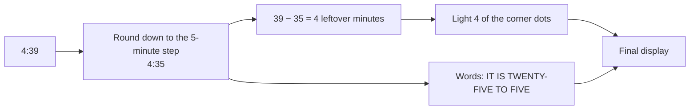
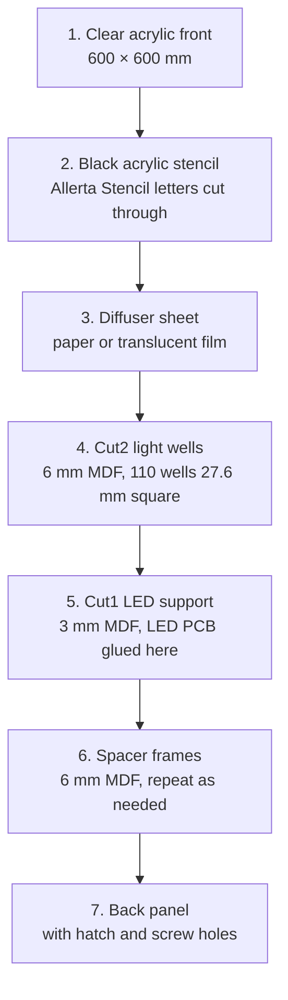
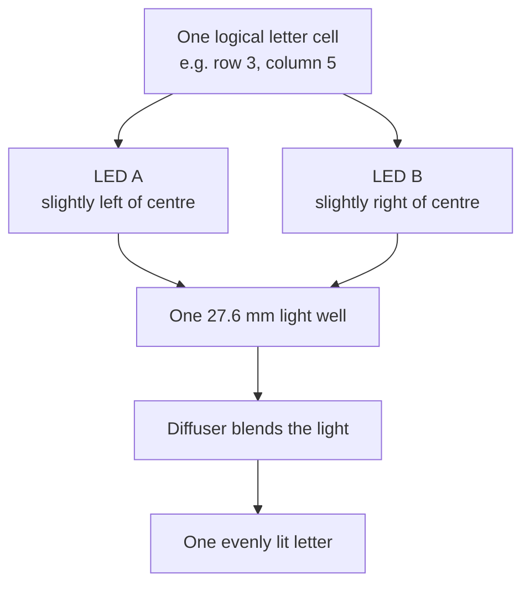
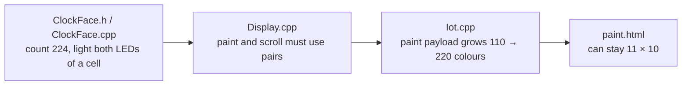
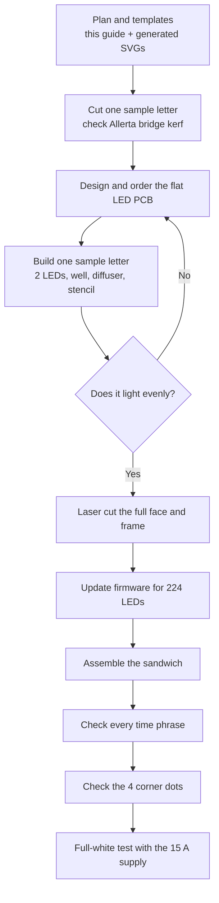

# 60 cm Wordclock — Full Build Guide

This is the detailed guide for the **60 cm × 60 cm English-only** version of the wordclock. It lives in this fork on branch `plan/60cm-wordclock`.

It is still a **plan**. The face and frame templates are ready to cut; the firmware and the flat LED board are not done yet.

- [Short plan](PLAN-60cm.md) — the decision list and numbers.
- [Template reference](hardware/60cm/README.md) — what each generated file is.
- [Original 30 cm project](README.md) — where this design came from.

---

## 1. What we are building

The original clock is 30 cm square with one LED behind each of the 110 letters. This version doubles the face to 60 cm and puts **two LEDs behind every letter** so the bigger letters light up evenly. The words, the word positions and the way time is shown do not change.

| | Original clock | 60 cm clock |
|---|---|---|
| Face | 30 × 30 cm | 60 × 60 cm |
| Letter grid | 11 columns × 10 rows | same |
| LEDs per letter | 1 | 2 |
| LEDs for letters | 110 | 220 |
| Corner minute dots | 4 | 4 |
| **Total LEDs** | **114** | **224** |
| Light wells | 110 small wells | 110 wells, 27.6 × 27.6 mm |
| Letter step | ~16.6 × 18.6 mm | 33.2 × 37.27 mm |
| Lit area | ~18 × 19 cm | ~37 × 37 cm |
| Power supply | 5 V / 6 A | 5 V / ~15 A |
| Face | painted and etched glass | clear acrylic + separate black stencil |
| LED mounting | LED strips | flat PCB with solder pads |

The key idea is that **the software still thinks in 11 × 10 letters**. All the "one letter = two LEDs" handling is added underneath it. That keeps the word code, the web paint tool and the scrolling text almost untouched.

---

## 2. How a time becomes light

```mermaid
flowchart LR
    A["Time source<br/>NTP over WiFi or DS3231 RTC"] --> B["ESP32 firmware"]
    B --> C["EnglishClockFace<br/>picks the words for this time"]
    C --> D["Display<br/>maps each letter cell to two LEDs"]
    D --> E["224 WS2812B LEDs<br/>on one flat PCB"]
    E --> F["One light well per letter"]
    F --> G["Diffuser sheet<br/>blends the two LED points"]
    G --> H["Black stencil<br/>the letter shape"]
    H --> I["Clear acrylic front"]
    I --> J["You read the time"]
```



A few things are worth calling out:

- **The ESP32 does not know anything about millimetres.** It only knows LED numbers 0–223.
- **The diffuser matters.** Without it, two bare LEDs would show as two bright dots inside each letter instead of one evenly lit letter.
- **The stencil does the shaping.** The LEDs and wells just make a soft glowing square; the cut letter in the black sheet is what your eye actually reads.

---

## 3. The letter grid

The 110 letters are fixed in an 11 × 10 grid. Lowercase letters below are filler letters that the clock never lights — they exist so the paint web tool and the scroller can still show any letter of the alphabet.

```text
col:  0 1 2 3 4 5 6 7 8 9 10
row 0 I T l I S a s A M  P  M
row 1 A c Q U A R T E R  d  c
row 2 T W E N T Y F I V E x
row 3 H A L F s T E N u T  O
row 4 P A S T b u N I N E
row 5 O N E S I X T H R E E
row 6 F O U R F I V E T W O
row 7 E I G H T E L E V E N
row 8 S E V E N T W E L V E
row 9 T E N s z O ' C L O C K
```

The firmware stores each word as `x, y, length`. For example `TWENTY-FIVE` is `x=0, y=2, length=10`, and `O'CLOCK` is `x=5, y=9, length=7`.

Time is shown in **5-minute steps**. The four corner LEDs hold the leftover 1–4 minutes.



This behaviour is inherited unchanged from the original clock. We are not adding words like "FOUR THIRTY-NINE" because that would need more letters, smaller glyphs, four times as many LEDs and a full rewrite of the word coordinates.

---

## 4. The face sandwich

The front is a stack of separate sheets, viewed from the front:



Why this arrangement:

- **Clear acrylic in front** is lighter than glass, will not shatter, and is cheap to replace. No spray paint, no etching, no two-tone acrylic.
- **Black stencil behind it** gives the letters their shape. It is a separate sheet, so a mistake only costs one cheap sheet.
- **One well per letter.** We tried the idea of splitting each cell into a top and bottom well, but the letters sit at different heights inside their cells, so a fixed split cuts through some glyphs. One big well per letter is simpler and correct.
- **Diffuser between LEDs and stencil** removes the visible two-dot pattern.
- **Square corners are kept**, so the four corner minute LEDs stay in the original positions.

### Why the font changed

With the original letter outlines, letters such as `A`, `D`, `O`, `P`, `Q` and `R` have a floating centre piece. Once the clock is mounted on a wall, that piece drops to the bottom of its cut-out. Clamping holds it front-to-back but not sideways.

The production stencil therefore uses **Allerta Stencil** (Google Fonts, OFL licence). Its letters have built-in bridges and open counters, so there is no loose island to fall. The original outlines are kept as a backup cut file in case the bridges do not cut cleanly.

---

## 5. The frame layers

The frame is laser-cut MDF, glued together like a sandwich.

| Layer | Material | File | Job |
|---|---|---|---|
| Cut2 | 6 mm MDF | `cut/frame_cut2_lightwells_600.svg` | 110 wells that guide light to each letter |
| Cut1 | 3 mm MDF | `cut/frame_cut1_600.svg` | Holds the flat LED PCB; has the controller cavity |
| Spacers | 6 mm MDF | `cut/frame_spacers_600.svg` | Empty frames that create room for the board and wiring |
| Back | back panel | `cut/frame_back_600.svg` | Hatch for access, four screw holes |

Two features in the overlay often raise questions:

- The **blue box** is a 200 × 100 mm hole in Cut1. It is the **controller cavity** — space for the ESP32, RTC and wiring behind the LED board. It was widened from 160 mm to give more room and is centred on the panel.
- The **orange box** is a 100 × 30 mm notch in the bottom rail of the spacer frames. It is the **cable pass-through** that lets wires run from the controller area into the rest of the stack.

Other fixed details:

- Corner LED holes are 12 mm across.
- Registration holes sit at `(15, 300)` and `(585, 300)`, outside the spacer's inner cut line, so the two face sheets line up.
- The cut files use red (`#ff0000`) 0.5 mm strokes on a 600 × 600 mm sheet.

---

## 6. LEDs and wiring



- 220 LEDs are arranged as 10 rows of 11 cells, two per cell.
- 4 more LEDs sit in the square corners for the leftover minutes.
- Total: **224 LEDs**.
- Data wiring stays serpentine as in the original build. Power should feed in from several points on the board rather than one end, because 224 white LEDs can draw about 13 A.
- Nodo-specific LED mapping is **not** used. This is our own board, like the original ESP32 build.

Before ordering a full board, build one sample letter with two LEDs and check that it looks evenly lit through a well, diffuser and stencil.

---

## 7. Firmware work still to do

The firmware in `software/` is still the 30 cm version. The words stay exactly where they are; only the two-LEDs-per-letter rule is new.



| File | Change needed | Status |
|---|---|---|
| `software/wordclock/src/src/ClockFace.h` | LED count and grid constants | To do |
| `software/wordclock/src/src/ClockFace.cpp` | `pixelCount()`, word state, mapping for pairs | To do |
| `software/wordclock/src/src/Display.cpp` | Every paint/scroll call lights both LEDs | To do |
| `software/wordclock/src/src/Iot.cpp` | Paint API message from 110 to 220 colours | To do |
| `software/wordclock/src/paint.html` | No change — still 11 × 10 logical letters | Fine as is |

The firmware can be built with PlatformIO. See [software/README.md](software/README.md) for flashing and OTA instructions, and [software/UsersManual.md](software/UsersManual.md) for the web interface.

---

## 8. Files in this fork

```text
hardware/60cm/
├── cut/            # the six files to send to the cutter
├── backup/         # original stencil outlines, kept as a backup
├── preview/        # layer overlays and font comparison (never cut)
├── fonts/          # the OFL font files used for the stencil and previews
├── src/_60cm/      # the Python generator
├── README.md       # short template reference
├── pyproject.toml
└── uv.lock
```

| Folder | What is in it |
|---|---|
| `cut/` | `faceplate_clear_600.svg`, `faceplate_EN_stencil_600.svg`, `frame_cut1_600.svg`, `frame_cut2_lightwells_600.svg`, `frame_spacers_600.svg`, `frame_back_600.svg` |
| `backup/` | `faceplate_EN_stencil_original_600.svg` — the original 30 cm-derived outlines |
| `preview/` | `overlay_600.svg` (the real stack), the backup/font comparison overlays and `font_compare.png` |
| `fonts/` | Allerta Stencil, Stardos Stencil Bold/Regular, Big Shoulders Stencil Display |

The original 30 cm templates are archived in `hardware/_archive_30cm/`.

### Regenerating the SVGs

From `hardware/60cm/`:

```powershell
uv sync
uv run 60cm
```

The generator reads the archived 30 cm geometry and the English letter positions, then writes every SVG into the folders above. Do not hand-edit the generated SVGs — change the generator instead.

---

## 9. What still needs deciding

- One large PCB (~37 × 37 cm) or ten smaller boards, one per row. One board is closer to the Nodo idea; smaller boards are cheaper and easier to replace.
- Mounting: concealed clips fixed from the back are preferred so nothing shows on the front.
- Which workshop can cut 600 mm acrylic and MDF.
- Exact component positions and connector placement on the board.
- Final letter size after the sample-letter test.

---

## 10. Build order



Skip nothing in that chain: a bad bridge kerf or a dim sample letter is much cheaper to fix before cutting the full 600 mm sheets.
