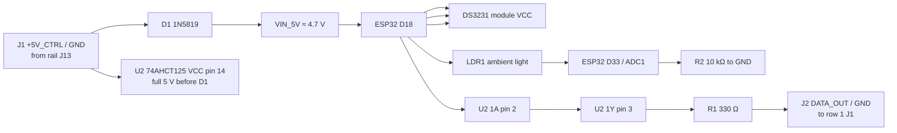

# 60 cm Word Clock — Controller PCB Build Guide

**Created:** 2026-11-26  
**Branch:** `plan/60cm-pcb-v2`  
**Source of truth:** the controller parts/netlist supplied by the user on 2026-11-26, plus `PCB_V2_REFERENCE.md`.  
**Status:** Design/build guide only. Create the KiCad project in the GUI; no controller project files were generated here.

This guide is self-contained. It replaces the earlier “controller on protoboard” decision: the controller is now a **fabricated PCB** that fits inside the bottom frame cavity.

---

## 0. Fixed decisions

- One controller PCB, not a protoboard.
- Frame cavity is **200 × 100 mm** at `x=200…500`, `y=500…600`.
- Use a **190 × 90 mm** outline, centred in the cavity with 5 mm clearance:
  - Frame position `x=205…395`, `y=505…595`.
  - Board-local coordinates are `(0,0)` to `(190,90)`.
- 2 layers, FR4, 1.6 mm, 1 oz copper. **HASL only**; no ENIG.
- 30-pin ESP32 DevKit, CH340C, USB-C. USB is for programming only.
- SMD where practical: 74AHCT125 in SOIC-14, 1N5819 in SOD-123, 330 Ω and 10 kΩ resistors in 0805, 100 nF in 0805, and 100 µF as SMD electrolytic.
- 74AHCT125 level shifter powered from **5 V**.
- DS3231 RTC module powered from ESP32 **3.3 V**; module already has I²C pull-ups.
- 1N5819 Schottky diode in series on the 5 V feed to ESP32 VIN.
- Ambient light sensor: LDR1 on ESP32 **3V3** → ESP32 `D33` ADC1, with a 10 kΩ pulldown to GND. Same idea as the original 30 cm clock: automatic brightness adjustment, not a lidar.
- Data out: `ESP32 D18 → 74AHCT125 → 330 Ω → J2 → row 1 DIN`.
- Never connect 5 V to ESP32 `3V3` or any GPIO.
- One GND net everywhere: rail, controller, rows, corners.

---

## 1. Block diagram

---

## 2. BOM — per board

| Ref | Qty | Component | Notes | Suggested KiCad footprint |
|---|---:|---|---|---|
| `U1` | 1 | ESP32 DevKit 30-pin, CH340C, USB-C | **Create footprint from the real board.** Antenna at bottom. | Custom 2×15, 2.54 mm pitch, 1.0 mm drill / 1.7 mm pad starting point |
| `U2` | 1 | 74AHCT125, SOIC-14 | SMD level shifter; powered from 5 V. | `Package_SO:SOIC-14_3.9x8.7mm_P1.27mm` |
| `U3` | 1 | DS3231 RTC module | 4–6 pin header module; has its own pull-ups. | `Connector_PinHeader_2.54mm:PinHeader_1x04_P2.54mm_Vertical` or matching module header |
| `D1` | 1 | 1N5819 Schottky, SOD-123 | Anode on `+5V_CTRL`, cathode on `VIN_5V`. | `Diode_SMD:D_SOD-123` |
| `R1` | 1 | 330 Ω, 0805 | Series data resistor, close to U2 pin 3. | `Resistor_SMD:R_0805_2012Metric` |
| `R2` | 1 | 10 kΩ, 0805 | Pulldown for LDR1 divider. | `Resistor_SMD:R_0805_2012Metric` |
| `C1` | 1 | 100 µF SMD electrolytic | On `VIN_5V`, after D1. 10 V or 16 V, 105 °C. Observe polarity. | `Capacitor_SMD:CP_Elec_6.3x5.8` — verify real part |
| `C2` | 1 | 0.1 µF ceramic, 0805 | `VIN_5V` to GND, near ESP32 VIN. | `Capacitor_SMD:C_0805_2012Metric` |
| `C3` | 1 | 0.1 µF ceramic, 0805 | Right at U2 pins 14 and 7. | `Capacitor_SMD:C_0805_2012Metric` |
| `LDR1` | 1 | Light dependent resistor, e.g. LDR 5537 | Ambient light sensor. Keep THT and expose it to room light. | Generic THT photoresistor, 2.54 mm pitch, ~5 mm disc — verify real part |
| `J1` | 1 | 2-pin screw terminal | Power in from rail `J13`. | `TerminalBlock_4Ucon:TerminalBlock_4Ucon_1x02_P3.50mm_Horizontal` |
| `J2` | 1 | 2-pin screw terminal | Data out to row 1. | Same as `J1` |
| `J3` | 1 | Optional GPIO header | Skip unless needed later. | `Connector_PinHeader_2.54mm:PinHeader_1x06_P2.54mm_Vertical` |
| `H1`–`H4` | 4 NPTH | M3 clearance hole | Exclude from BOM. | `MountingHole:MountingHole_3.2mm_M3` |

Purchaser part for `J1`/`J2`: DORABO `DB301V-3.5-2P-GN-S`, LCSC **`C695629`** — same 2-pin terminal used on the rail outputs.

---

## 3. Symbol and footprint workaround for modules

You do **not** need a perfect ESP32 or DS3231 symbol. In KiCad, the schematic symbol only holds pin numbers; the physical holes come from the **footprint** assigned to that symbol. Use a generic connector symbol with the right pin count, then assign the custom/header footprint.

### 3.1 ESP32 symbol — use a generic connector

Use `Connector_Generic:Conn_02x15_Odd_Even` for `U1`.

- Reference: `U1`
- Value: `ESP32 DevKit 30-pin CH340C USB-C`
- Footprint: custom `ESP32_DevKit_30pin_CH340C_USB_C` from section 3.2

That symbol numbers the left row `1,3,5…29` top → bottom and the right row `2,4,6…30` top → bottom. Map it to the real module like this:

| Pad | Signal | Pad | Signal |
|---:|---|---:|---|
| 1 | `3V3` | 2 | `VIN` |
| 3 | `GND` | 4 | `GND` |
| 5 | `D15` | 6 | `D13` |
| 7 | `D2` | 8 | `D12` |
| 9 | `D4` | 10 | `D14` |
| 11 | `D16` | 12 | `D27` |
| 13 | `D17` | 14 | `D26` |
| 15 | `D5` | 16 | `D25` |
| 17 | `D18` | 18 | `D33` |
| 19 | `D19` | 20 | `D32` |
| 21 | `D21` | 22 | `D35` |
| 23 | `RX0` | 24 | `D34` |
| 25 | `TX0` | 26 | `VN` |
| 27 | `D22` | 28 | `VP` |
| 29 | `D23` | 30 | `EN` |

Wires used by this clock:

| Net | ESP32 generic-symbol pad |
|---|---|
| `3V3` | 1 |
| `GND` | 3 and 4 |
| `VIN_5V` | 2 |
| `LED_DATA` from `D18` | 17 |
| `SDA` from `D21` | 21 |
| `SCL` from `D22` | 27 |
| `LDR_ADC` on `D33` | 18 |

Do **not** trust a library footprint blindly. Clones vary by 1–2 mm.

### 3.2 ESP32 footprint — make the holes

1. Measure the real module with calipers: row-to-row hole spacing `R`, pin diameter, body width and antenna length.
2. In Footprint Editor, create `ESP32_DevKit_30pin_CH340C_USB_C`.
3. Place 30 THT pads:
   - Left column X = `0`, right column X = `R`.
   - Pad 1 at `(0,0)`, pad 29 at `(0,35.56)`.
   - Pad 2 at `(R,0)`, pad 30 at `(R,35.56)`.
   - 2.54 mm pitch down each column.
   - Start with **1.0 mm drill / 1.7 mm pad**, then adjust to the measured pin diameter.
4. Add silkscreen outline and courtyard. Add the antenna keepout on the PCB as described in section 5.
5. Print this footprint at **1:1** and test-fit the real ESP32 before ordering.

### 3.3 DS3231 module symbol — use a generic connector

Use the pin count your real module has:

- 4-pin module: `Connector_Generic:Conn_01x04` + `Connector_PinHeader_2.54mm:PinHeader_1x04_P2.54mm_Vertical`
- 6-pin module: `Connector_Generic:Conn_01x06` + `Connector_PinHeader_2.54mm:PinHeader_1x06_P2.54mm_Vertical`

Set reference `U3`, value `DS3231 module`. Wire `VCC → 3V3`, `GND → GND`, `SDA → D21`, `SCL → D22`. Leave `SQW`, `RST`, `32K` unconnected unless you later use them. Write the actual pin order from the module silkscreen onto the schematic; do not guess it from another board.

---

## 4. Netlist

### Power

| From | To | Notes |
|---|---|---|
| `J1.1` | `+5V_CTRL` | From rail `J13.1`. |
| `J1.2` | `GND` | From rail `J13.2`. |
| `+5V_CTRL` | `D1` anode | Full 5 V. |
| `D1` cathode | `VIN_5V` | About 4.7 V. |
| `VIN_5V` | ESP32 `VIN` | Never connect to `3V3`. |
| `C1`, `C2` | `VIN_5V` ↔ `GND` | Close to ESP32 VIN. |
| `+5V_CTRL` | U2 pin 14 | Level shifter gets full 5 V **before** D1. |
| `C3` | U2 pin 14 ↔ pin 7 | As close as possible. |
| ESP32 `3V3` | U3 VCC | RTC module on 3.3 V. |
| ESP32 `3V3` | LDR1 | Light-sensor divider top. 3.3 V only. |
| All GND pins | `GND` | J1, ESP32 both GND pins, U2 pin 7, U3, J2 pin 2, R2. |

### Signals

| From | To | Notes |
|---|---|---|
| ESP32 `D18` | U2 pin 2 (`1A`) | 3.3 V LED data. |
| U2 pin 1 (`1OE`) | `GND` | Channel 1 always enabled. |
| U2 pin 3 (`1Y`) | `R1` pin 1 | 5 V logic. |
| `R1` pin 2 | `J2.1` (`DATA_OUT`) | Keep R1 close to U2. |
| `J2.2` | `GND` | Run beside data wire. |
| ESP32 `D21` | U3 `SDA` | I²C data. |
| ESP32 `D22` | U3 `SCL` | I²C clock. |
| LDR1 bottom | `LDR_ADC` → ESP32 `D33` | ADC1 input; firmware default is GPIO33. Do not move to ADC2 if Wi-Fi is used. |
| `LDR_ADC` | R2 → `GND` | 10 kΩ pulldown. Brighter light gives a higher ADC reading. |

### Unused 74AHCT125 channels

| Pins | Connection |
|---|---|
| `2A`, `3A`, `4A` = pins 5, 9, 12 | Tie to `GND` |
| `2OE`, `3OE`, `4OE` = pins 4, 10, 13 | Tie to `+5V_CTRL` |
| `2Y`, `3Y`, `4Y` = pins 6, 8, 11 | Leave unconnected |

### Unused ESP32 pins

`D33` is now used for LDR1. Route the rest to optional `J3` or leave unconnected. Avoid `GPIO0`, `2`, `5`, `12`, `15` for anything important because they are boot-strapping pins. `D34`, `D35`, `VP`, `VN` are input-only.

---

## 5. Starting placement

Board-local outline is `(0,0)` to `(190,90)`. Terminal X/Y is **pad 1**. Other X/Y values are body centres.

| Ref | Footprint | X | Y | Rotation | Notes |
|---|---|---:|---:|---:|---|
| `H1` | `MountingHole_3.2mm_M3` | 10 | 10 | 0° | NPTH |
| `H2` | `MountingHole_3.2mm_M3` | 180 | 10 | 0° | NPTH |
| `H3` | `MountingHole_3.2mm_M3` | 10 | 80 | 0° | NPTH |
| `H4` | `MountingHole_3.2mm_M3` | 180 | 80 | 0° | NPTH |
| `J1` | `TerminalBlock_4Ucon_1x02_P3.50mm_Horizontal` | 20 | 4 | 0° | Pin 1 `+5V_CTRL`, pin 2 `GND`; opening up |
| `J2` | `TerminalBlock_4Ucon_1x02_P3.50mm_Horizontal` | 40 | 4 | 0° | Pin 1 `DATA_OUT`, pin 2 `GND`; opening up |
| `D1` | `D_SOD-123` | 25 | 14 | 0° | SMD; stripe/cathode to the right |
| `C1` | `CP_Elec_6.3x5.8` | 118 | 48 | 0° | SMD + pin toward `VIN_5V`, near ESP32 VIN |
| `C2` | `C_0805_2012Metric` | 112 | 38 | 0° | Next to ESP32 VIN pin |
| `U2` | `SOIC-14_3.9x8.7mm_P1.27mm` | 60 | 24 | 0° | SMD; pin 1 marked on silkscreen |
| `C3` | `C_0805_2012Metric` | 55 | 16 | 0° | At U2 pins 14/7 |
| `R1` | `R_0805_2012Metric` | 52 | 10 | 0° | 330 Ω, close to U2 pin 3 |
| `R2` | `R_0805_2012Metric` | 165 | 32 | 0° | 10 kΩ LDR pulldown |
| `LDR1` | THT photoresistor, 2.54 mm pitch | 180 | 25 | 0° | Expose at the right edge; face the open side of the cavity |
| `U3` | DS3231 module header | 140 | 24 | 0° | Module body may extend toward the right |
| `U1` | Custom 2×15 ESP32 footprint | 95 | — | 0° | USB-C top, antenna bottom; row gap `R` measured |
| `J3` | Optional 1×06 header | 165 | 55 | 0° | Leave unpopulated if unused |

For `U1`, place the **top pin of each row at local Y = 42**. The 15 pins then run down at 2.54 mm pitch to Y = 77.56. Set the two row X positions to `95 − R/2` and `95 + R/2`, where `R` is the measured row-to-row spacing.

### Antenna keepout

Add a ruled keepout area on **both F.Cu and B.Cu**:

- Local rectangle `(80,80)` to `(110,90)`.
- No tracks, no zones, no vias, no pads, no silkscreen over the antenna body.

If the real antenna is longer than that, either extend the keepout to the board edge or let the antenna end overhang the bottom edge of the PCB. Do not put copper under the antenna.

### Placement in the frame

| Item | Frame coordinates |
|---|---|
| Controller PCB outline | `x=205…395`, `y=505…595` |
| `J1` pad 1 | `(225,509)` |
| `J2` pad 1 | `(245,509)` |

Adjust module positions only after the 1:1 ESP32 footprint fit is confirmed. Do not change the outline or the four M3 holes. Leave a small opening in the bottom spacer/frame so `LDR1` sees room light; do not cover it with insulation or a label.

---

## 6. KiCad schematic

1. Create a new project in `hardware/60cm/kicad/wordClock/controllerPCB/`.
2. Place symbols:
   - `Connector_Generic:Conn_01x02` for `J1` and `J2`.
   - `Connector_Generic:Conn_02x15_Odd_Even` for `U1`; assign the custom ESP32 footprint from section 3.2 and use the pad map in section 3.1.
   - `74xx:74AHCT125` for `U2`.
   - `Connector_Generic:Conn_01x04` or `Conn_01x06` for `U3`, matching the real DS3231 module header; see section 3.3.
   - `Device:D_Schottky` with value `1N5819` for `D1`.
   - `Device:R` = `330` for `R1`, `10k` for `R2`.
   - Generic photoresistor/LDR symbol for `LDR1`; a 2-pin resistor symbol labelled `LDR1` is fine.
   - `Device:C` = `100uF`, `100nF`, `100nF` for `C1`, `C2`, `C3`.
   - `Mechanical:MountingHole` ×4.
   - `power:PWR_FLAG` on `+5V_CTRL`, `3V3`, and `GND`.
3. Wire exactly the nets in section 4.
4. Add labels: `+5V_CTRL`, `VIN_5V`, `3V3`, `GND`, `DATA_OUT`, `SDA`, `SCL`, `LED_DATA`, `LDR_ADC`.
5. Annotate and run ERC. Target: no unconnected inputs or power pins and no power-input conflicts; ignore intentionally unconnected U2 outputs and unused ESP32/DS3231 pins.
6. Update PCB from schematic.

---

## 7. Board setup

In `File → Board Setup → Design Rules`:

| Rule | Value |
|---|---|
| Clearance | **0.15 mm minimum**, 0.2–0.3 mm preferred |
| Signal track width | **0.25 mm** |
| Power track width | **2.0 mm minimum** |
| Via | **0.70 mm pad / 0.40 mm hole** |

Net classes:

| Class | Clearance | Track | Use |
|---|---:|---:|---|
| `Default` | 0.15 mm | 0.25 mm | Data, I²C, GPIO |
| `CTRL_PWR` | 0.15 mm | 2.0 mm | `+5V_CTRL`, `VIN_5V`, `GND` tracks |

Patterns:

| Pattern | Class |
|---|---|
| `*+5V_CTRL` | `CTRL_PWR` |
| `*VIN_5V` | `CTRL_PWR` |
| `GND` | `CTRL_PWR` |

Current is under 1 A, so 1 mm would work electrically. Use 2 mm for margin.

---

## 8. PCB GUI steps

1. Draw `Edge.Cuts` rectangle `(0,0)` to `(190,90)`.

2. Place `H1`–`H4`, `J1`, `J2`, `D1`, `C1`, `C2`, `U2`, `C3`, `R1`, `R2`, `LDR1`, `U3`, `U1`, and optional `J3` from section 5.

3. Add the antenna keepout on both layers before routing.

4. Route power first:
   - `J1.1` → `+5V_CTRL` → `D1` anode → `VIN_5V` → ESP32 `VIN`, 2.0 mm.
   - Branch `+5V_CTRL` to U2 pin 14 **before** D1, 2.0 mm or zone.
   - `C1`/`C2` from `VIN_5V` to GND, short and direct.
   - `C3` directly across U2 pins 14 and 7.

5. Route signals:
   - ESP32 `D18` → U2 pin 2, 0.25 mm.
   - U2 pin 1 → GND.
   - U2 pin 3 → R1 → J2.1, 0.25 mm, short.
   - ESP32 `D21` → U3 SDA, `D22` → U3 SCL.
   - ESP32 `3V3` → LDR1 → `LDR_ADC` → ESP32 `D33`; R2 from `LDR_ADC` to GND, 0.25 mm. Keep this analog line short and away from the LED data line.
   - Tie unused 74AHCT125 pins as in section 4.

6. Add zones **after routing**:
   - `B.Cu`, net `GND`, full board minus a 0.5 mm edge inset.
   - Optional `F.Cu` GND zone with stitching vias, but keep it out of the antenna keepout.
   - Press `B` to fill.

7. Silkscreen:
   - `+5V` and `GND` at `J1`.
   - `DATA_OUT` and `GND` at `J2`.
   - `+`/`−` on `C1`, stripe end on `D1`.
   - Pin 1 mark on U2.
   - Pin labels near every ESP32 pin, especially `VIN`, `3V3`, `GND`, `D18`, `D21`, `D22`, `D33`.
   - `LDR1` / `LIGHT` at the exposed sensor.
   - `ANTENNA KEEPOUT` near the bottom edge.

### Optional Freerouting

This board is mostly manual routing. If you use Freerouting:

1. Export before adding zones.
2. Keep the netclasses from section 7.
3. Re-import and widen any sub-0.20 mm tracks to 0.25 mm.
4. Add zones, refill, then run DRC.

---

## 9. DRC

Target: **0 violations, 0 unconnected items, 0 schematic parity errors**.

Check specifically:

- No copper, zone, or via inside the antenna keepout.
- No `+5V_CTRL` on ESP32 `3V3` or any GPIO.
- U2 pin 14 is on `+5V_CTRL`, not `VIN_5V`.
- D1 direction is anode → cathode from `+5V_CTRL` to `VIN_5V`.
- C1 polarity is correct.
- `LDR1` divider is fed only from `3V3`; `LDR_ADC` goes only to ESP32 `D33` and R2 to GND.
- All GND pins are on one net.
- All drills are ≥ 0.40 mm except the M3 NPTH holes and terminal pin drills.

---

## 10. Gerbers and drills

1. `File → Plot…`, Gerber:
   - `F.Cu`
   - `B.Cu`
   - `F.Silkscreen`
   - `F.Mask`
   - `B.Mask`
   - `F.Paste` — required because U2, D1, R1/R2 and C1–C3 are SMD
   - `Edge.Cuts`

2. Generate Excellon drills in mm. Expected:
   - 30 × ~1.0 mm ESP32 pin drills, if using the custom 1.0 mm footprint.
   - 14 × 1.2 mm terminal pin drills for `J1`/`J2`.
   - 2 × THT drills for `LDR1` (match the real part, usually ~0.8–1.0 mm).
   - 4 × 3.2 mm NPTH M3 holes.
   - Header drills for `U3`, plus extra drills if `J3` is populated. `U2` is SMD, so no DIP socket holes.

3. Zip into one fabrication set. Order one board locally, or 5 if using JLCPCB.

HASL finish. No ENIG.

---

## 11. Wiring to the rest of the clock

| Harness | From | To | Notes |
|---|---|---|---|
| `PWR-CTRL` | Rail `J13.1` / `J13.2` | Controller `J1.1` / `J1.2` | `+5V_CTRL` / `GND`. 18 AWG / 0.75 mm². |
| `DATA-1` | Controller `J2.1` / `J2.2` | Row 1 `J1.3` / `J1.4` | `DATA_OUT` / `GND`. Twist together. |

Never feed the controller from ESP32 USB while the rail is connected. USB is programming only.

---

## 12. Assembly and bring-up

1. Solder the THT parts first: U3 header, LDR1, optional J3, then J1/J2.
2. Reflow or hot-air solder the SMD parts: U2, D1, R1, R2, C1, C2, C3. A fine-tip iron also works for SOIC-14 and 0805. Check D1 stripe and C1 polarity.
3. Solder the custom ESP32 footprint last, or use female headers if preferred.
4. Before inserting the ESP32:
   - Check `J1.1` → D1 anode ≈ 0 Ω.
   - D1 cathode → ESP32 VIN pad ≈ 0 Ω.
   - No short between `+5V_CTRL` and `GND`.
   - U2 pin 14 connects to `+5V_CTRL`, not `VIN_5V`.
5. Insert ESP32 and power from the rail only.
6. Measure:
   - ESP32 `VIN` ≈ 4.7 V.
   - ESP32 `3V3` ≈ 3.3 V.
   - U2 pin 14 ≈ 5 V.
   - `LDR_ADC` rises in bright light and falls when `LDR1` is covered.
7. Check U2 pin 3 toggles with `D18` before connecting the LED chain.
8. Connect row 1 data only after power rails are verified.

Firmware uses GPIO18 for LED data, GPIO21/22 for I²C, GPIO33 for the LDR, and 224 LEDs total. Cap brightness to about 50–60% in firmware. The original software already reads GPIO33 by default and exposes a light-sensor sensitivity setting, so no firmware pin change is needed.

---

## 13. Checklist before ordering

- [ ] Board outline is 190 × 90 mm and fits `x=205…395`, `y=505…595`.
- [ ] ESP32 footprint printed at 1:1 and test-fitted.
- [ ] ESP32 pin order matches section 3.
- [ ] Antenna keepout present on both layers.
- [ ] `J1`/`J2` openings face up, pin 1 on the left.
- [ ] D1 anode on `+5V_CTRL`, cathode on `VIN_5V`.
- [ ] U2 pin 14 on `+5V_CTRL`, C3 at pins 14/7.
- [ ] U2/D1/R1/R2/C1–C3 use the chosen SMD footprints; F.Paste is exported.
- [ ] LDR1 is exposed to room light; R2 is 10 kΩ from `LDR_ADC` to GND; `LDR_ADC` goes to ESP32 `D33`.
- [ ] ESP32 `3V3` never tied to 5 V.
- [ ] Unused 74AHCT125 pins tied as specified.
- [ ] GND zone on B.Cu, DRC clean.
- [ ] HASL, no ENIG.

---

Skipped: no KiCad project, schematic, PCB, or Gerber files were generated here.  
Risk: the ESP32 footprint must be measured and 1:1 test-fitted; if the antenna keepout is missed, Wi-Fi/Bluetooth performance will suffer. The LDR must actually see room light, or the auto-dim feature will do nothing.
