# 60 cm Word Clock — Corner PCB Build Guide

**Created:** 2026-11-25  
**Branch:** `plan/60cm-pcb-v2`  
**Source of truth:** `word-clock-pcb-design.md` and `PCB_V2_REFERENCE.md`.  
**Status:** Design/build guide only. Create the KiCad project in the GUI; no corner project files were generated here.

This guide is self-contained. It covers the four one-LED corner boards used to fill the four corner light-wells of the 60 cm clock.

---

## 0. Fixed decisions

- Four corner boards, **30 × 30 mm maximum**.
- **One KiCad project, one schematic, one PCB file, one Gerber set.** All four corners use the same finished board.
- One WS2812B per board. Total corner LEDs: **4**. Total clock LEDs: **224**.
- Two **4-pin screw terminals** per board:
  - `J1` = power/data input.
  - `J2` = power/data output to the next corner. The last corner’s `J2` stays unwired.
- Use the **same 3.50 mm 4Ucon footprint** as row `J1`:
  - `TerminalBlock_4Ucon:TerminalBlock_4Ucon_1x04_P3.50mm_Horizontal`
  - Purchaser part: DORABO `DB125-3.5-4P-GN-S`, LCSC **`C2757925`**.
- No JST-XH. No XT60. Screw terminals only.
- 2 layers, FR4, 1.6 mm, 1 oz copper. **HASL only**, leaded or lead-free whichever is cheaper. No ENIG.
- One GND net everywhere.
- The corner chain is the **only** allowed power daisy-chain: rail → corner 1 → 2 → 3 → 4.
- Never feed a row from a corner board.

### One PCB design, rotated at each corner

Use **one** corner PCB design for all four corners. The same 30 × 30 mm board is physically rotated inside its envelope:

| Corner | Board rotation | LED global `(X,Y)` | M3 hole globals |
|---|---:|---|---|
| Top-left | 0° | `(40.06,40.05)` | `(55.06,35.05)`, `(35.06,55.05)` |
| Top-right | 90° clockwise | `(559.94,40.05)` | `(544.94,35.05)`, `(564.94,55.05)` |
| Bottom-left | 270° clockwise | `(40.06,559.95)` | `(35.06,544.95)`, `(55.06,564.95)` |
| Bottom-right | 180° | `(559.94,559.95)` | `(564.94,544.95)`, `(544.94,564.95)` |

The board-local LED is always `(10,10)` and the board-local holes are always `(25,5)` and `(5,25)`. Rotation changes where they land in the 600 mm frame. This is physical rotation of the finished PCB during assembly, not a different KiCad footprint rotation.

---

## 1. What the corner board does

```mermaid
flowchart LR
    RAIL["Rail J12<br/>+5V_CORNER / GND"]
    RAIL --> C1J1["Corner 1 J1<br/>power + DIN"]
    C1J1 --> L1["L1 WS2812B"]
    L1 --> C1J2["Corner 1 J2<br/>power + DOUT"]
    C1J2 --> C2J1["Corner 2 J1"]
    C2J1 --> L2["L2 WS2812B"]
    L2 --> C2J2["Corner 2 J2"]
    C2J2 --> C3J1["Corner 3 J1"]
    C3J1 --> L3["L3 WS2812B"]
    L3 --> C3J2["Corner 3 J2"]
    C3J2 --> C4J1["Corner 4 J1"]
    C4J1 --> L4["L4 WS2812B"]
    L4 --> UNUSED["Corner 4 J2<br/>left unwired"]
```

Data order is an assumption; firmware will remap LED indices. The electrical chain is still fixed as above.

---

## 2. Nets and rules

| Net | Where it exists |
|---|---|
| `+5V_CORNER` | `J1.1`, `J2.1`, LED `L1.1`, 100 nF `C1.1`, rail `J12.1` |
| `GND` | `J1.2`, `J1.4`, `J2.2`, `J2.4`, LED `L1.3`, capacitor `C1.2`, rail `J12.2` |
| `DIN` | `J1.3` → LED `L1.4` |
| `DOUT` | LED `L1.2` → `J2.3` |

Rules:

- `J2.1`/`J2.2` carry power to the **next corner only**.
- `J2.3`/`J2.4` carry data/ground to the **next corner only**.
- `J2` never feeds a row board.
- `J1.4` and `J2.4` are extra GND pins to keep data return next to data. Tie them to the same GND net.
- Last corner’s `J2` stays electrically present but has no external wires.

---

## 3. Connector pinout

Both terminals are the same 4-pin 4Ucon footprint. Pin numbers matter more than physical position.

| Ref | Function | Pin 1 | Pin 2 | Pin 3 | Pin 4 | Rotation | Wire opening |
|---|---|---|---|---|---|---:|---|
| `J1` | Input | `+5V_CORNER` | `GND` | `DIN` | `GND` | 0° | Up / outward edge |
| `J2` | Output | `+5V_CORNER` | `GND` | `DOUT` | `GND` | 180° | Down / inward edge |

With `J2` at 180°, the physical left-to-right order is reversed: `GND (4)`, `DOUT (3)`, `GND (2)`, `+5V (1)`. Wire by pin number.

The table is in board-local orientation. After the physical board rotations in section 5, `J1` still faces the outside frame edge and `J2` faces the centre. Confirm the wire openings in the 3D viewer (`Alt+3`). If the 3D model shows a terminal opening facing into the board, fix that terminal’s footprint rotation once in this single PCB file; do **not** move the hole positions.

---

## 4. BOM — per board

| Ref | Qty | Component | Value / part | KiCad symbol | KiCad footprint | Notes |
|---|---:|---|---|---|---|---|
| `L1` | 1 | WS2812B-V5 | Worldsemi `WS2812B-B/W`, LCSC **`C114586`** | `LED:WS2812B` | `LED_SMD:LED_WS2812B_PLCC4_5.0x5.0mm_P3.2mm` | Same LED as row board. |
| `C1` | 1 | 100 nF | Murata `GRM21BR71H104KA01L`, LCSC **`C77082`**, 0805 / 50 V / X7R | `Device:C` | `Capacitor_SMD:C_0805_2012Metric` | One per LED. |
| `J1`, `J2` | 2 | 4-pin screw terminal | DORABO `DB125-3.5-4P-GN-S`, LCSC **`C2757925`** | `Connector_Generic:Conn_01x04` | `TerminalBlock_4Ucon:TerminalBlock_4Ucon_1x04_P3.50mm_Horizontal` | Same as row `J1`. |
| `H1`, `H2` | 2 NPTH | M3 clearance hole | Ø3.2 mm | `Mechanical:MountingHole` | `MountingHole:MountingHole_3.2mm_M3` | Exclude from BOM. |

For four boards: **4 LEDs, 4 × 100 nF, 8 × 4-pin terminals, 8 × M3 holes**.

A 470 µF bulk capacitor is **not needed**: four LEDs are only about 0.25 A worst case. Skip it. If you later add one, put it only at corner 1 after dry-fitting; it will crowd the 30 × 30 mm outline.

---

## 5. Mechanical coordinates

Board local outline is `(0,0)` to `(30,30)`. Terminal coordinates are **pad 1**. LED and capacitor coordinates are body centres.

### One board, local coordinates

| Ref | Footprint | X | Y | Rotation | Notes |
|---|---|---:|---:|---:|---|
| `H1` | `MountingHole_3.2mm_M3` | 25 | 5 | 0° | NPTH |
| `H2` | `MountingHole_3.2mm_M3` | 5 | 25 | 0° | NPTH |
| `L1` | `LED_WS2812B_PLCC4_5.0x5.0mm_P3.2mm` | 10 | 10 | 0° | LED centre |
| `C1` | `C_0805_2012Metric` | 16 | 10 | 0° | 100 nF |
| `J1` | `TerminalBlock_4Ucon_1x04_P3.50mm_Horizontal` | 7.5 | 3 | 0° | Input, opening up |
| `J2` | `TerminalBlock_4Ucon_1x04_P3.50mm_Horizontal` | 22.5 | 26 | 180° | Output, opening down |

The top terminal courtyard extends about 0.9 mm past the board edge. That is intentional for this side-entry terminal; all copper pads and drills stay inside the board.

### Placement in the 600 mm frame

| Frame position | Envelope top-left `(x,y)` | Board rotation | LED global `(x,y)` | M3 hole globals |
|---|---|---:|---|---|
| Top-left | `(30.06,30.05)` | 0° | `(40.06,40.05)` | `(55.06,35.05)`, `(35.06,55.05)` |
| Top-right | `(539.94,30.05)` | 90° clockwise | `(559.94,40.05)` | `(544.94,35.05)`, `(564.94,55.05)` |
| Bottom-left | `(30.06,539.95)` | 270° clockwise | `(40.06,559.95)` | `(35.06,544.95)`, `(55.06,564.95)` |
| Bottom-right | `(539.94,539.95)` | 180° | `(559.94,559.95)` | `(564.94,544.95)`, `(544.94,564.95)` |

Rotate the finished board **in plane only**. Do not mirror it or flip it over; the holes and terminal openings only line up in the rotations shown. These positions match the four Ø12 corner light-wells and the eight M3 frame holes.

---

## 6. KiCad schematic

Create **one** schematic and **one** PCB file. All four corners are assembled from this same design; do not duplicate the circuit.

1. Place these symbols:
   - `Connector_Generic:Conn_01x04` for `J1`, value `CORNER_IN`.
   - `Connector_Generic:Conn_01x04` for `J2`, value `CORNER_OUT`.
   - `LED:WS2812B` for `L1`, value `WS2812B-V5`.
   - `Device:C` for `C1`, value `100nF`.
   - `Mechanical:MountingHole` for `H1`, `H2`.
   - `power:PWR_FLAG` on `+5V_CORNER` and `GND` only to satisfy ERC.

2. Add global/local labels:
   - `+5V_CORNER` on `J1.1`, `J2.1`, LED pin 1, capacitor pin 1.
   - `GND` on `J1.2`, `J1.4`, `J2.2`, `J2.4`, LED pin 3, capacitor pin 2.
   - `DIN` on `J1.3` and LED pin 4.
   - `DOUT` on LED pin 2 and `J2.3`.

3. Annotate and run ERC. Target: no unconnected pins.

4. Update PCB from schematic.

---

## 7. Board setup

In `File → Board Setup → Design Rules`:

| Rule | Value |
|---|---|
| Clearance | **0.15 mm** |
| Minimum track width | **0.20 mm** |
| Default track width | **0.25 mm** |
| Via / hole | **0.70 / 0.40 mm** |
| Zone clearance | **0.25 mm** |

Net classes:

| Class | Clearance | Track | Use |
|---|---:|---:|---|
| `Default` | 0.15 mm | 0.25 mm | `DIN`, `DOUT`, `GND` |
| `CORNER_PWR` | 0.15 mm | 1.0 mm | `+5V_CORNER` |

Pattern assignment:

| Pattern | Class |
|---|---|
| `*+5V_CORNER` | `CORNER_PWR` |

Do **not** copy the rail project’s 3.0 mm `POWER` class into this board. It is far too wide for a 30 × 30 mm board.

---

## 8. PCB GUI steps

1. Draw `Edge.Cuts` rectangle from `(0,0)` to `(30,30)`.

2. Place `H1`, `H2`, `L1`, `C1`, `J1`, `J2` from the one-board coordinate table.

3. Confirm footprint rotations in the PCB file:
   - `J1` = 0°, opening up.
   - `J2` = 180°, opening down.
   - `L1` = 0°.
   - `C1` = 0°.

   These are local rotations. The physical rotation at each frame corner is in section 5.

4. Route:
   - `J1.3` → `L1.4` = `DIN`, 0.25 mm.
   - `L1.2` → `J2.3` = `DOUT`, 0.25 mm.
   - `+5V_CORNER` tracks = 1.0 mm if not carried by the zone.
   - GND uses the bottom zone; short top-side GND stubs may be 0.25 mm.

5. Add zones **after routing**:
   - `F.Cu`, net `+5V_CORNER`, rectangle `(0.5,0.5)` to `(29.5,29.5)`, clearance 0.25 mm.
   - `B.Cu`, net `GND`, rectangle `(0.5,0.5)` to `(29.5,29.5)`, clearance 0.25 mm.
   - Add two GND stitching vias at about `(3,17)` and `(27,17)`, 0.70 / 0.40 mm.
   - Press `B` to fill.

6. Silkscreen:
   - `+5V`, `GND`, `DIN`, `DOUT` beside each terminal.
   - `CORNER LED` near `L1`.
   - Do not print `C1`–`C4` on the PCB; all four boards share one Gerber. Mark corner identity on the harness or connector instead.

### Optional Freerouting

This board has only four nets; manual routing is faster. If you use Freerouting:

1. Do not add zones before exporting.
2. Export `corner.dsn`.
3. Keep clearance 0.15 mm and the netclasses from section 7.
4. Route, save `.ses`, import back into KiCad.
5. Check imported track widths. Freerouting may import 0.1874 mm tracks; widen anything below 0.20 mm to **0.25 mm**, and set `+5V_CORNER` tails to **1.0 mm**.
6. Add zones, refill with `B`, then run DRC.

---

## 9. DRC

Target: **0 violations, 0 unconnected items, 0 schematic parity errors**.

Check specifically:

- No courtyard overlap with `H1`/`H2`.
- No `+5V_CORNER` on `B.Cu`.
- `J2.1` is `+5V_CORNER`, not `DIN` or `DOUT`.
- `J1.4` and `J2.4` are GND.
- All drills are ≥ 0.40 mm.

If DRC reports thin 0.1874 mm tracks, widen them to 0.25 mm. Do not delete top-side GND stubs near `L1`/`C1`; they may be the only link to a GND via.

---

## 10. Gerbers and drills

Export one fabrication set:

1. `File → Plot…`, Gerber:
   - `F.Cu`
   - `B.Cu`
   - `F.Silkscreen`
   - `F.Mask`
   - `B.Mask`
   - `Edge.Cuts`

2. Generate drill files:
   - Excellon, units mm.
   - Expected per board:
     - 8 × **1.2 mm** terminal pin drills
     - 2 × **3.2 mm** NPTH mounting holes
     - 2 × **0.40 mm** via drills if stitching vias were used

3. Zip the corner Gerbers/drills into one fabrication zip.

4. Order 5 boards if using JLCPCB; the clock needs 4.

HASL finish. No ENIG.

---

## 11. Wiring the four boards

| Harness | From | To | Notes |
|---|---|---|---|
| `PWR-C` | Rail `J12.1` / `J12.2` | Corner 1 `J1.1` / `J1.2` | 18 AWG / 0.75 mm² recommended. |
| `DATA-C01` | Row 10 `J2.1` / `J2.2` | Corner 1 `J1.3` / `J1.4` | Twist `DOUT + GND`. |
| `PWR-C12` | Corner 1 `J2.1` / `J2.2` | Corner 2 `J1.1` / `J1.2` | Allowed corner power chain. |
| `DATA-C12` | Corner 1 `J2.3` / `J2.4` | Corner 2 `J1.3` / `J1.4` | Twist data with GND. |
| `PWR-C23` | Corner 2 `J2.1` / `J2.2` | Corner 3 `J1.1` / `J1.2` | Allowed corner power chain. |
| `DATA-C23` | Corner 2 `J2.3` / `J2.4` | Corner 3 `J1.3` / `J1.4` | Twist data with GND. |
| `PWR-C34` | Corner 3 `J2.1` / `J2.2` | Corner 4 `J1.1` / `J1.2` | Allowed corner power chain. |
| `DATA-C34` | Corner 3 `J2.3` / `J2.4` | Corner 4 `J1.3` / `J1.4` | Twist data with GND. |
| — | Corner 4 `J2` | nothing | Leave unwired. |

Do not use a corner board to feed a row. Rows come only from their own rail fuses.

---

## 12. Assembly and bring-up

1. Solder `C1`, then `L1`, checking LED pin 1 orientation.
2. Solder `J1`, `J2`, then fit `H1`/`H2` hardware.
3. Check continuity:
   - `J1.1` to `J2.1` and `L1.1` ≈ 0 Ω.
   - all GND pins ≈ 0 Ω to `J1.2`.
   - `J1.3` to `L1.4` ≈ 0 Ω.
   - `L1.2` to `J2.3` ≈ 0 Ω.
4. Check there is no short between `+5V_CORNER` and `GND`.
5. Power corner 1 from the rail only. Expected draw is about 0.25 A at full white.
6. Chain corners, then feed data. If one corner is dark, check `DIN`/`DOUT` direction before changing firmware.

---

## 13. Checklist before ordering

- [ ] One Gerber set exists.
- [ ] Board outline is exactly 30 × 30 mm.
- [ ] LED `(10,10)`, holes `(25,5)` and `(5,25)` in the PCB file.
- [ ] `J1` rotation 0°, `J2` rotation 180° in the PCB file.
- [ ] Assembly uses section 5 rotations: top-left 0°, top-right 90° clockwise, bottom-left 270° clockwise, bottom-right 180°.
- [ ] No board is mirrored or flipped.
- [ ] Both terminals are 4-pin 3.50 mm 4Ucon, LCSC `C2757925`.
- [ ] `+5V_CORNER` on top, `GND` solid on bottom.
- [ ] All drills ≥ 0.40 mm.
- [ ] HASL, no ENIG.
- [ ] DRC clean after zone refill.
- [ ] Corner 4 `J2` is left unwired in the harness.

---

Skipped: no corner KiCad project, schematic, PCB, or Gerber files were generated here.  
Risk: rotate in plane only; mirroring or flipping the board moves the holes away from the frame M3 positions and points the terminals inward.
