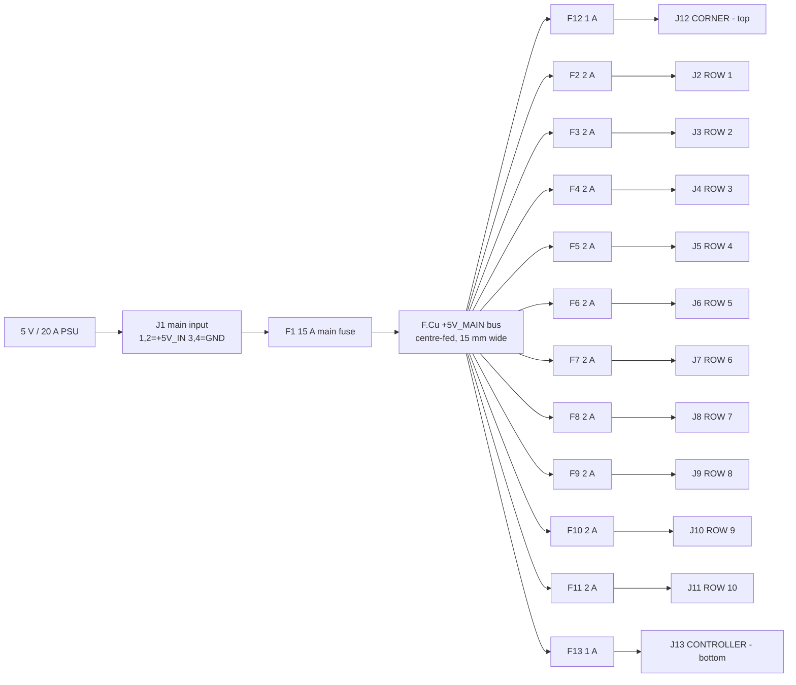

# Power Rail PCB — 12-Output Fused 5 V Distribution Board Build Guide

**Status:** active build guide, created 2026-11-25  
**Scope:** one power distribution PCB, quantity 1  
**Spec:** see `PCB_V2_REFERENCE.md` and `word-clock-pcb-design.md`  
**Do not edit:** any old/deleted `power_rail_v2` project. The existing `wordClock/powerRailPCB/` folder may contain an empty starter project; open it or create a new project in that folder.

This file is enough to create the power rail PCB without asking me. Follow it in order.

---

## 1. Locked decisions for this board

| Item | Value |
|---|---|
| Board size | **50 × 320 mm** |
| Position in 600 mm frame | Global `x = 60…110`, `y = 140…460` |
| Local coordinate origin | Board top-left = `(0, 0)`, X right, Y down. All coordinates in **mm**. |
| Copper | 2 layers, **2 oz** preferred, FR4, 1.6 mm |
| Copper finish | **HASL, leaded or lead-free**, whichever is cheaper. No ENIG. |
| Input | One 5 V / 20 A PSU feed into the **centre** of the board |
| Main protection | **15 A mini blade fuse** before the distribution copper |
| Branch protection | 10 × **2 A**, 1 × **1 A**, 1 × **1 A** mini blade fuses |
| Outputs | 12 isolated fused `+5V` outputs; **one common GND** |
| Main input connector | **4-pin 3.50 mm screw terminal**, same 4Ucon footprint as row `J1` |
| Output connectors | **2-pin 3.50 mm screw terminal**, same 4Ucon footprint as row `J2` |
| Fuse holders | PCB-mount mini blade holders, XFCN `XF-508P-B-B`, on the stock KiCad `Fuse:Fuseholder_Blade_Mini_Keystone_3568` footprint |
| Bulk capacitance | **2 × 470 µF / 10 V / 105 °C SMD electrolytic** in parallel ≈ 940 µF |
| Layer plan | `F.Cu` = main `+5V_MAIN` bus + short fused output tails; `B.Cu` = solid GND |
| Mounting | 4 × M3 NPTH holes, Ø3.2 mm |
| Silkscreen | Label every terminal, every fuse rating, and both capacitor polarities |
| Data | None. This board carries power only. |

**Why 2 oz:** this one board carries the whole clock current. Its area is only 160 cm², so the surcharge is small, and 2 oz gives useful margin for the 15 A centre feed. If the quote is high, 1 oz is acceptable **only if** you keep the full 15 mm main bus and do not narrow the pours.

**Why screw terminals, not XT60:** the rail uses the same 3.50 mm fixed screw terminals as the row PCBs. No crimp tool, easy to service. The main input uses a 4-pin terminal with **two poles per rail** because one 3.50 mm pole is only about 8 A; never feed 15 A through a single pole. XT60 is not needed.

**Why two 470 µF instead of one 1000 µF:** the two chosen 470 µF parts are the same in-stock SMD part already used on the row boards. Two in parallel give 940 µF, close enough to the ~1000 µF input target, and keep the board fully SMT except the terminals and fuse holders.

---

## 2. Wiring overview



Rules:

- Power is a **star**. Row 1 output is not connected to row 2 input. Every row gets its own fuse and its own two-wire cable from this board.
- **GND is never fused.** All 13 output GND pins and the two input GND poles connect to the same bottom-layer GND plane.
- The `+5V` outputs are **separate nets** after their fuses. Do not pour one continuous top-layer `+5V` over the output terminals; that would bypass the fuses.
- Firmware still caps brightness to about 50–60%. Full white on all 224 LEDs is about 13.4 A.

### Cable labels

| Label | Rail end | Load end | Conductors | Size | Notes |
|---|---|---|---|---|---|
| `PWR-IN` | PSU | `J1.1`/`J1.2` = `+5V_IN`, `J1.3`/`J1.4` = `GND` | 2 × `+5V_IN`, 2 × `GND` | 16 AWG / 1.5 mm² per wire recommended | Four short wires from the PSU: two per rail. Do not put both `+5V` wires under one screw. |
| `PWR-C` | `J12` | Corner 1 `+5V`, `GND` | `+5V_CORNER`, `GND` | 18 AWG / 0.75 mm² | Top output; terminal faces upward. Corner data comes separately from the data chain. |
| `PWR-R1`…`PWR-R10` | `J2`…`J11` | Row board `J1.1` = `+5V`, row board `J1.2` = `GND` | `+5V_Rn`, `GND` | 18 AWG / 0.75 mm² | Ten grouped middle outputs; one independent 2 A fused feed per row. |
| `PWR-CTRL` | `J13` | Controller protoboard `5V`, `GND` | `+5V_CTRL`, `GND` | 18 AWG / 0.75 mm² | Bottom output. Never connect to ESP32 `3V3`. |

Each row’s data cable is a separate twisted `DOUT + GND` pair from the previous row or controller. That data wiring does **not** enter this rail board.

---

## 3. Connector pinouts and net names

`J1` is a 4-pin screw terminal; `J2`…`J13` are 2-pin screw terminals. Pin numbers are the KiCad footprint pin numbers; verify the physical order in the 3D viewer before wiring.

| Connector | Pin | Net | Purpose |
|---|---:|---|---|
| `J1` main input | 1 | `+5V_IN` | From PSU, before F1 |
| `J1` main input | 2 | `+5V_IN` | Second PSU positive pole, before F1 |
| `J1` main input | 3 | `GND` | Common ground |
| `J1` main input | 4 | `GND` | Second PSU ground pole |
| `J12` corner output (top) | 1 | `+5V_CORNER` | Fused corner-chain power |
| `J12` corner output (top) | 2 | `GND` | Common ground |
| `J2`…`J11` row outputs | 1 | `+5V_R1`…`+5V_R10` | Fused row power |
| `J2`…`J11` row outputs | 2 | `GND` | Common ground |
| `J13` controller output (bottom) | 1 | `+5V_CTRL` | Fused controller power |
| `J13` controller output (bottom) | 2 | `GND` | Common ground |

### Net list

| Net | Where it exists |
|---|---|
| `+5V_IN` | `J1.1`, `J1.2`, `F1` input only |
| `+5V_MAIN` | `F1` output, `C1`, `C2`, all output fuse inputs |
| `+5V_R1`…`+5V_R10` | One output fuse + one row terminal each |
| `+5V_CORNER` | `F12` + `J12.1` |
| `+5V_CTRL` | `F13` + `J13.1` |
| `GND` | Everywhere: `J1.3`, `J1.4`, all output pin 2, both capacitor negatives, bottom plane |

`J1.1`/`J1.2` are both `+5V_IN`; `J1.3`/`J1.4` are both `GND`. Use two separate PSU wires per rail. Paralleling pads on the PCB does **not** make one screw clamp a 15 A contact.

Do not create `DIN`, `DOUT`, or LED data nets on this board.

### Mini blade fuse holder pin numbering

The purchased XFCN holder has four through-hole pins but only two electrical contacts. In the stock `Fuse:Fuseholder_Blade_Mini_Keystone_3568` footprint:

- the two **left** pads are both pad **1** = fuse input;
- the two **right** pads are both pad **2** = fuse output.

This matches a normal 2-pin fuse symbol. Duplicate pad numbers are intentional. The footprint origin is the upper-left input pad, not the body centre.

---

## 4. Parts, references, footprints and coordinates

All coordinates are local to the rail PCB. Board outline is `(0,0)` to `(50,320)`.

### Full bill of materials

| Ref(s) | Qty | Component | Value / part | KiCad symbol | KiCad footprint | Notes |
|---|---:|---|---|---|---|---|
| `J1` | 1 | 4-pin screw terminal | 4Ucon 20001 type, 3.50 mm, ~8 A/pole | `Connector_Generic:Conn_01x04` | `TerminalBlock_4Ucon:TerminalBlock_4Ucon_1x04_P3.50mm_Horizontal` | Main PSU input: two poles for `+5V_IN`, two for `GND`. |
| `J2`…`J13` | 12 | 2-pin screw terminal | 4Ucon 19963 type, 3.50 mm, ~8 A/pole | `Connector_Generic:Conn_01x02` | `TerminalBlock_4Ucon:TerminalBlock_4Ucon_1x02_P3.50mm_Horizontal` | One terminal per fused output. |
| `F1` | 1 holder + 1 fuse | Mini blade fuse holder + **15 A** mini blade fuse | Holder XFCN `XF-508P-B-B`; fuse ATM/APM 15 A | `Device:Fuse` — search `Fuse` if needed | `Fuse:Fuseholder_Blade_Mini_Keystone_3568` | Fuse is a consumable, not a PCB footprint. |
| `F2`…`F11` | 10 holders + 10 fuses | Mini blade fuse holder + **2 A** mini blade fuse | Same holder; ATM/APM 2 A | `Device:Fuse` | `Fuse:Fuseholder_Blade_Mini_Keystone_3568` | One per row. |
| `F12`, `F13` | 2 holders + 2 fuses | Mini blade fuse holder + **1 A** mini blade fuse | Same holder; ATM/APM 1 A | `Device:Fuse` | `Fuse:Fuseholder_Blade_Mini_Keystone_3568` | Corner chain and controller. |
| `C1`, `C2` | 2 | SMD aluminium electrolytic | **470 µF, 10 V, 105 °C**, SAMYOUNG `BXJ10V470UF8*10`, 8 × 10 mm | `Device:C_Polarized` | `Capacitor_SMD:CP_Elec_8x10.5` | In parallel after F1. Polarity matters. |
| `H1`…`H4` | 4 NPTH | Mounting hole | M3 clearance, Ø3.2 mm | `Mechanical:MountingHole` | `MountingHole:MountingHole_3.2mm_M3` | Not a purchased PCB part. |

### LCSC / purchaser quick reference

Prices and stock change; codes were checked on 2026-11-25.

| Refs | Qty | MPN | Manufacturer | LCSC # | Notes |
|---|---:|---|---|---|---|
| `J1` | 1 | `DB125-3.5-4P-GN-S` (or `OSTTF040161`) | DORABO (or On-Shore) | **`C2757925`** (`C6249335` = 0 stock) | Same footprint as row `J1`; two `+5V` poles and two GND poles. |
| `J2`…`J13` | 12 | `DB301V-3.5-2P-GN-S` (or `OSTTF020161`) | DORABO (or On-Shore) | **`C695629`** (`C6722704` = 0 stock) | Same footprint as row `J2`. |
| `F1`…`F13` holders | 13 | `XF-508P-B-B` | XFCN | **`C19727305`** | 15 A clip, DIP-4, in stock. Fits the stock KiCad mini-blade footprint; see §6A. |
| `F1` fuse | 1 | Mini blade / ATM / APM **15 A** | Any reputable brand | — | Buy locally with spares. |
| `F2`…`F11` fuses | 10 | Mini blade / ATM / APM **2 A** | Any reputable brand | — | Buy at least 15 spares. |
| `F12`, `F13` fuses | 2 | Mini blade / ATM / APM **1 A** | Any reputable brand | — | Buy at least 5 spares. |
| `C1`, `C2` | 2 | `BXJ10V470UF8*10` | SAMYOUNG | **`C2693598`** | Same part as row-board `C23`. |
| `H1`…`H4` | 4 | — | — | — | NPTH hardware, not ordered as components. |

The stock KiCad footprint is named after the Keystone `3568` holder, but that exact Keystone part currently shows 0 stock at LCSC. Buy the XFCN `C19727305` instead; its 9.80 mm pin pitch fits the stock footprint's 9.92 mm pads with only 0.06 mm offset per pin.

Footprint strings are KiCad library names, not purchaser part numbers. The rail uses the same 4Ucon footprints as the row boards; the in-stock purchases above are DORABO parts that fit those footprints. Dry-fit one of each before the bulk order.

Mechanical hardware, not on the PCB BOM: **4 × M3 screws**, **4 × M3 nuts**, and **4 × 6 mm M3 standoffs** to match the frame holes.

### Fixed-part coordinates

Terminal coordinates are **pad 1**, not body centre, exactly like the row PCB. Fuse coordinates are **pad 1 of the stock footprint** (upper-left input pad); the fuse body centre stays at X = 22 and Y = pad-1 Y + 1.7. Capacitor coordinates are body centre.

| Ref | Footprint | X | Y | Rotation | Notes |
|---|---|---:|---:|---:|---|
| `H1` | `MountingHole_3.2mm_M3` | 5 | 5 | 0° | NPTH |
| `H2` | `MountingHole_3.2mm_M3` | 45 | 5 | 0° | NPTH |
| `H3` | `MountingHole_3.2mm_M3` | 5 | 315 | 0° | NPTH |
| `H4` | `MountingHole_3.2mm_M3` | 45 | 315 | 0° | NPTH |
| `J1` | 4Ucon `...1x04_P3.50mm_Horizontal` | 8 | 160 | 270° | PSU input, wire openings face left. Pins 1/2 (bottom) = `+5V_IN`; pins 3/4 (top) = `GND`. |
| `F1` | `Fuse:Fuseholder_Blade_Mini_Keystone_3568` | 17.04 | 158.30 | 0° | 15 A main fuse; body centre `(22,160)`. |
| `C1` | `CP_Elec_8x10.5` | 8 | 140 | 0° | `+` to `+5V_MAIN`. |
| `C2` | `CP_Elec_8x10.5` | 8 | 180 | 0° | `+` to `+5V_MAIN`. |

`J1` at 270° reads top-to-bottom `GND (pin 4)`, `GND (pin 3)`, `+5V (pin 2)`, `+5V (pin 1)`. Wire openings face the left edge.

### Output coordinates and labels

Use `TerminalBlock_4Ucon:TerminalBlock_4Ucon_1x02_P3.50mm_Horizontal` for every output. All output pad-1 positions are at X = **42**. `J12` (corner) is at the top with rotation **0°** so its wire opening faces **up**; pin 1 `+5V` is on the left and pin 2 `GND` on the right. `J2`…`J11` and `J13` use rotation **90°**, wire openings facing the right edge, pin 1 `+5V` on top and pin 2 `GND` below. If the 3D viewer shows a 90° terminal opening facing inward, change only that terminal to **270°**; do not move the hole positions.

| Rail output | Terminal ref | Terminal pad-1 Y | Rotation | Fuse ref | Fuse pad-1 `(X,Y)` | Fuse rating | Net | Silkscreen label |
|---|---|---:|---:|---|---|---:|---|---|
| Corner | `J12` | 16 | 0° | `F12` | `(17.04, 14.30)` | 1 A | `+5V_CORNER` | `CORNER - 1A` |
| Row 1 | `J2` | 48 | 90° | `F2` | `(17.04, 46.30)` | 2 A | `+5V_R1` | `ROW 1 - 2A` |
| Row 2 | `J3` | 80 | 90° | `F3` | `(17.04, 78.30)` | 2 A | `+5V_R2` | `ROW 2 - 2A` |
| Row 3 | `J4` | 112 | 90° | `F4` | `(17.04, 110.30)` | 2 A | `+5V_R3` | `ROW 3 - 2A` |
| Row 4 | `J5` | 128 | 90° | `F5` | `(17.04, 126.30)` | 2 A | `+5V_R4` | `ROW 4 - 2A` |
| Row 5 | `J6` | 144 | 90° | `F6` | `(17.04, 142.30)` | 2 A | `+5V_R5` | `ROW 5 - 2A` |
| Row 6 | `J7` | 176 | 90° | `F7` | `(17.04, 174.30)` | 2 A | `+5V_R6` | `ROW 6 - 2A` |
| Row 7 | `J8` | 192 | 90° | `F8` | `(17.04, 190.30)` | 2 A | `+5V_R7` | `ROW 7 - 2A` |
| Row 8 | `J9` | 208 | 90° | `F9` | `(17.04, 206.30)` | 2 A | `+5V_R8` | `ROW 8 - 2A` |
| Row 9 | `J10` | 240 | 90° | `F10` | `(17.04, 238.30)` | 2 A | `+5V_R9` | `ROW 9 - 2A` |
| Row 10 | `J11` | 272 | 90° | `F11` | `(17.04, 270.30)` | 2 A | `+5V_R10` | `ROW 10 - 2A` |
| Controller | `J13` | 304 | 90° | `F13` | `(17.04, 302.30)` | 1 A | `+5V_CTRL` | `CTRL - 1A` |

The corner is first at the top, the ten row outputs are grouped in the middle, and the controller is last at the bottom. The row slots reuse the old 32 mm grid with two 16 mm gaps where the corner and controller used to sit; that uneven pitch is fine. It does **not** need to equal the 37.2714 mm row-PCB pitch.

### Physical layout sketch

```text
Local X: 0                                                     50
        +------------------------------------------------------+
Y=5     | H1                                               H2   |
        |      F12-J12  CORNER (0deg, wire up)                 |
        |      F2--J2    ROW 1                                 |
        |      F3--J3    ROW 2                                 |
        |      F4--J4    ROW 3                                 |
        |      F5--J5    ROW 4                                 |
        | C1  F6--J6    ROW 5                                  |
Y=160   | J1(4P)--F1    MAIN INPUT + 15 A FUSE                   |
        | C2  F7--J7    ROW 6                                  |
        |      F8--J8    ROW 7                                 |
        |      F9--J9    ROW 8                                 |
        |      F10-J10   ROW 9                                 |
        |      F11-J11   ROW 10                                |
        |      F13-J13   CONTROLLER                            |
Y=315   | H3                                               H4   |
        +------------------------------------------------------+
```

`C1` is at Y=140 and `C2` at Y=180; the sketch compresses them for readability. Corner is first at the top, controller last at the bottom.

---

## 5. KiCad schematic — do these steps in order

The existing `wordClock/powerRailPCB/` folder may already contain an empty KiCad 10 project. Use it if present. Do not restore the deleted `power_rail_v2` project.

1. Open the schematic editor.

2. Place these symbols:

   | Qty | Symbol | Value | Footprint to assign |
   |---:|---|---|---|
   | 1 | `Connector_Generic:Conn_01x04` | `PSU_IN` | `TerminalBlock_4Ucon:TerminalBlock_4Ucon_1x04_P3.50mm_Horizontal` |
   | 12 | `Connector_Generic:Conn_01x02` | `CORNER`, `ROW1`…`ROW10`, `CTRL` | `TerminalBlock_4Ucon:TerminalBlock_4Ucon_1x02_P3.50mm_Horizontal` |
   | 13 | `Device:Fuse` | `15A`, `2A`, `1A` as per §4 | `Fuse:Fuseholder_Blade_Mini_Keystone_3568` |
   | 2 | `Device:C_Polarized` | `470u` | `Capacitor_SMD:CP_Elec_8x10.5` |
   | 4 | `Mechanical:MountingHole` | `M3` | `MountingHole:MountingHole_3.2mm_M3` |
   | 1 | `Power:PWR_FLAG` on `+5V_IN` | — | — |
   | 1 | `Power:PWR_FLAG` on `GND` | — | — |

   If your library calls the fuse symbol `Fuse:Fuse` instead of `Device:Fuse`, search for `Fuse` and use the 2-pin one.

3. Annotate so references become `J1`…`J13`, `F1`…`F13`, `C1`, `C2`, `H1`…`H4`.

4. Add net labels:

   `+5V_IN`, `+5V_MAIN`, `+5V_R1`, `+5V_R2`, `+5V_R3`, `+5V_R4`, `+5V_R5`, `+5V_R6`, `+5V_R7`, `+5V_R8`, `+5V_R9`, `+5V_R10`, `+5V_CORNER`, `+5V_CTRL`, `GND`.

   Do not use physical wires for the whole schematic if labels are clearer. Labels are electrically identical.

5. Wire `J1`:

   - `J1.1` and `J1.2` → `+5V_IN`
   - `J1.3` and `J1.4` → `GND`

6. Wire `F1`:

   - Input side → `+5V_IN`
   - Output side → `+5V_MAIN`

7. Wire `C1` and `C2`:

   - Pin 1 / `+` → `+5V_MAIN`
   - Pin 2 / `−` → `GND`

8. Wire the output fuses:

   | Fuse | Input | Output |
   |---|---|---|
   | `F12` | `+5V_MAIN` | `+5V_CORNER` |
   | `F2`…`F11` | `+5V_MAIN` | `+5V_R1`…`+5V_R10` respectively |
   | `F13` | `+5V_MAIN` | `+5V_CTRL` |

9. Wire the connectors:

   - `J12.1` → `+5V_CORNER`
   - `J2.1`…`J11.1` → `+5V_R1`…`+5V_R10`
   - `J13.1` → `+5V_CTRL`
   - `J12.2`, `J2.2`…`J11.2`, `J13.2` → `GND`

10. Leave `H1`…`H4` unwired. They have no pins.

11. Run **ERC**. Target: **0 violations**.  
    If KiCad says the power nets are not driven, confirm the two `PWR_FLAG` symbols are present.

12. Press `F8` to update the PCB.

---

## 6. KiCad PCB — do these steps in order

### 6.0 First-run PCB editor setup

1. Set units to **mm** and grid to **0.1 mm**.

2. Open `File → Board Setup…`:

   - **Board Stackup:** 2 copper layers, board thickness **1.6 mm**, copper **2 oz / 0.070 mm**. If your fab only offers 1 oz, use 1 oz but keep the full-width bus described in §6C.
   - **Design Rules → Constraints:**
     - Clearance: **0.15 mm**
     - Minimum track width: **0.20 mm**
     - Minimum via diameter: **0.70 mm**
     - Minimum via drill: **0.40 mm**
     - Copper-to-edge clearance: **0.50 mm**
   - **Net Classes:**
     - `Default`: clearance **0.15 mm**, track **0.25 mm**, via **0.70 / 0.40 mm**
     - Add `POWER`: clearance **0.15 mm**, track **3.0 mm**, via **0.70 / 0.40 mm**
   - **Masks / Silkscreen:** solder mask expansion **0.05 mm**; text height **0.8 mm**, thickness **0.12 mm**.

3. Click OK and save.

### 6.1 Outline and mounting holes

1. Press `F8` if you have not already updated from the schematic.

2. Draw the board outline on `Edge.Cuts`: rectangle from `(0,0)` to `(50,320)`.

3. Switch the active layer back to **`F.Cu`**.

4. Place `H1`…`H4` at the fixed coordinates: `(5,5)`, `(45,5)`, `(5,315)`, `(45,315)`.

5. Confirm the global positions match the frame overlay: `(65,145)`, `(105,145)`, `(65,455)`, `(105,455)`.

### 6A. Use the stock mini blade fuse-holder footprint

No custom footprint is needed. Assign **`Fuse:Fuseholder_Blade_Mini_Keystone_3568`** to all 13 fuses.

1. In the schematic, set each fuse footprint to `Fuse:Fuseholder_Blade_Mini_Keystone_3568`, then press `F8` to update the PCB.

2. The stock footprint has four THT pads: two pad-1 input pins at X = 0 and two pad-2 output pins at X = 9.92 mm, with 3.40 mm row spacing and 1.78 mm drills.

3. The XFCN `XF-508P-B-B` drawing gives a 16.00 × 7.35 mm body, 9.80 mm pin pitch and 3.40 mm row spacing. The 0.12 mm pitch difference is only 0.06 mm offset per pin, well inside the 1.78 mm drill clearance. Its silkscreen body is slightly taller than the stock outline; trust the slot in the 3D viewer, not the silkscreen rectangle.

4. Dry-fit one holder on a printed 1:1 paper copy or scrap board before ordering all 13. If the pins do not drop in, stop and recheck the part number.

> shortcut: the stock Keystone-3568 footprint is reused for the XFCN holder because the pin geometry matches within 0.06 mm; upgrade to a part-specific footprint only if a dry-fit fails.

### 6.2 Place components

1. Place 4-pin `J1` at pad 1 `(8,160)`, rotation **270°**. Check the 3D viewer (`Alt+3`) that the wire openings face the left board edge and that pins 1/2 are the lower two poles.

2. Place 2-pin outputs at pad-1 coordinates from the output table, all X = 42. `J12` (corner) uses rotation **0°** with its wire opening facing up; pin 1 `+5V` is left, pin 2 `GND` right. `J2`…`J11` and `J13` use rotation **90°**; check that their wire openings face the right board edge and pin 1 is the upper `+5V` pole.

3. Place `F1` at footprint origin / pad 1 `(17.04,158.30)`, rotation `0°`. Its body centre is `(22,160)`.

4. Place `F2`…`F13` at the fuse pad-1 coordinates in the output table, rotation `0°`.

5. Place `C1` at `(8,140)` and `C2` at `(8,180)`, rotation `0°`. The `+` pad must face the main bus, not GND.

6. Confirm no courtyard overlaps:
   - `C1` body sits above the main input area; `C2` below it.
   - `F12` is at Y=16 (top) and `F13` at Y=304 (bottom); both are clear of `C1` at Y=140 and `C2` at Y=180.
   - `J1` occupies roughly X = 4…12; fuse holders occupy X = 14…30; output terminals occupy X ≈ 38…46.

### 6.3 Routing with Freerouting

Freerouting only connects pads that already have the **same net name**. It does not decide that a row feed is separate; the schematic labels do that. So before exporting, confirm these nets exist in the PCB:

- `+5V_IN` on `J1.1`, `J1.2` and the input side of `F1`
- `+5V_MAIN` on the output side of `F1`, both capacitors `+`, and every fuse **pad 1**
- one separate net per output: `+5V_R1`…`+5V_R10`, `+5V_CORNER`, `+5V_CTRL`, each on its fuse **pad 2** and terminal **pin 1**
- `GND` on `J1.3`, `J1.4`, every terminal **pin 2**, and both capacitor `−` pads

Flow:

1. Finish placement. **Do not add the zones yet** — add them after routing, exactly like the row board.
2. In `File → Board Setup → Net Classes`, keep your existing `POWER` class at **3.0 mm** and `Default` at **0.25 mm**; both use **0.15 mm** clearance and **0.70 / 0.40 mm** vias. Add two more classes:

   | Class | Clearance | Track | Via / hole | Use |
   |---|---:|---:|---:|---|
   | `PWR_2MM` | 0.15 mm | 2.0 mm | 0.70 / 0.40 mm | `+5V_MAIN`, `+5V_R1`…`+5V_R10` |
   | `PWR_1P5` | 0.15 mm | 1.5 mm | 0.70 / 0.40 mm | `+5V_CORNER`, `+5V_CTRL` |

   In the lower **net class assignment** table, add these rows. The leading `*` is intentional; it also matches names that have a sheet-path prefix such as `/+5V_IN`. Confirm the **Matching nets** column before closing:

   | Pattern | Class |
   |---|---|
   | `*+5V_IN` | `POWER` |
   | `*+5V_MAIN` | `PWR_2MM` |
   | `*+5V_R*` | `PWR_2MM` |
   | `*+5V_CORNER` | `PWR_1P5` |
   | `*+5V_CTRL` | `PWR_1P5` |

   Do not assign all `+5V*` nets to `POWER`; that would make the 1 A corner/controller tails 3.0 mm and the row tails 3.0 mm instead of 2.0 mm.

3. Safer option: manually draw and lock the high-current tails first:
   - `F2`…`F11` pad 2 → `J2`…`J11` pin 1, net `+5V_R1`…`+5V_R10`, **2.0 mm**;
   - `F12` pad 2 → `J12` pin 1, net `+5V_CORNER`, **1.5 mm**;
   - `F13` pad 2 → `J13` pin 1, net `+5V_CTRL`, **1.5 mm**;
   - both `J1.1` and `J1.2` → `F1` input pads, net `+5V_IN`, **3.0 mm**.

   Select each finished tail, press `E`, and tick **Locked** so Freerouting cannot thin or reroute it. Then export and let Freerouting finish only what is left. This board has no data nets, so there is very little left to route.
4. `File → Export → Specctra DSN…` → open in Freerouting → check the same rules → route → save `.ses`.
5. `File → Import → Specctra Session…` back in KiCad.
6. Check imported track widths. Freerouting can import ~0.1874 mm tracks even when a net class asks for more; use the bulk editor to set the power tails to 2.0 / 1.5 / 3.0 mm, or fix the net class and reroute. If the only DRC errors are `0.1874 mm` GND tracks, widen the GND tracks to **0.25 mm**; do not delete the short `F.Cu` GND tracks near the capacitors because they may be the only link from the SMD pads to GND vias.
7. Now go to §6C, add the two zones, press `B` to fill, then run DRC.

Do not worry if `GND` looks unrouted before the bottom zone exists — the zone in §6C is the return path. But if Freerouting adds thin GND tracks, they are harmless and can be left in place.

### 6C. Copper zones and current paths

Do this after placement. Zones matter more than traces on this board.

**Main `+5V_MAIN` bus — `F.Cu`:**

1. Click `F.Cu` in the Appearance panel.

2. Press `Ctrl+Shift+Z` (`Draw Filled Zones`).

3. Set **Net = `+5V_MAIN`**, **Layer = `F.Cu`**, **Clearance = 0.25 mm**, **Pad connection = Thermal reliefs**, **Remove islands = Always**.

4. Draw a vertical rectangle approximately from `(3,12)` to `(18,308)`. KiCad will clip it to the board edge and mounting holes.

5. Press `Esc` to leave the zone tool.

This bus is centre-fed by `J1 → F1` and runs up and down. At 2 oz and 15 mm width, the worst-case half-board voltage drop is tiny. Do not narrow this zone.

**Fused output tails — `F.Cu`:**

6. For each output, connect the fuse **pad 2** side to its terminal **pin 1** with a short, wide track:

   - rows: assign net `+5V_R1`…`+5V_R10`, track **2.0 mm** minimum;
   - corner and controller: assign `+5V_CORNER` / `+5V_CTRL`, track **1.5 mm** minimum.

   Keep each tail short and separate. Do not join two output tails.

7. Connect each fuse **pad 1** side to the `+5V_MAIN` zone with a short 2.0–3.0 mm track if the zone does not already touch it.

8. Connect **both** `J1.1` and `J1.2` to the `F1` input with **3.0 mm** tracks or a local `+5V_IN` pour, then through `F1` to `+5V_MAIN`. Both pads must be connected; do not feed the fuse from one pole only.

**GND plane — `B.Cu`:**

9. Click `B.Cu` in the Appearance panel.

10. Press `Ctrl+Shift+Z`. Set **Net = `GND`**, **Layer = `B.Cu`**, **Clearance = 0.25 mm**, **Pad connection = Thermal reliefs**, **Remove islands = Always**.

11. Draw a rectangle just inside the whole board outline, from about `(0.5,0.5)` to `(49.5,319.5)`, and finish with a double-click.

12. Add GND stitching vias around the free edges and in spare gaps, roughly every 20–25 mm. Use **0.70 / 0.40 mm** vias. Keep them out of the `+5V_MAIN` zone and away from the fused output tails.

13. Press `B` to fill all zones. Press `B` again after any move.

**Important:** there must be no `+5V` pour on `B.Cu`. The bottom layer is the single GND return for the whole system.

### 6D. Silkscreen

1. Click `F.Silkscreen`.

2. Press `Ctrl+Shift+T` (`Draw Text`), click the position, set height **0.8 mm**, thickness **0.12 mm**, and add:

   | Text | Approximate area |
   |---|---|
   | `PSU 5V IN - 1,2=+ / 3,4=GND` | near `J1`, left centre |
   | `F1 15A` | above `F1` |
   | `470uF +` / `470uF +` | above each capacitor |
   | `ROW 1 - 2A` … `ROW 10 - 2A` | beside each row terminal |
   | `CORNER - 1A` | beside `J12` |
   | `CTRL - 1A` | beside `J13` |
   | `STAR 5V - NO POWER CHAIN` | bottom centre |

3. Add polarity marks for both capacitors and pin-1 markers for the input terminals.

4. Press `Esc` to exit the text tool. Edit with `E`, delete with `Del`.

### 6E. DRC and fixes

1. Run **DRC**. Target: **0 violations, 0 unconnected items**.

2. If a high-current pad reports `starved_thermal`, either:
   - set that pad’s **Connection to copper zones = Solid**, or
   - edit the zone and set **Minimum spoke count = 2**.

   Solid connections are acceptable on fuse-holder and terminal pads; thermal reliefs on smaller pads are still preferred for hand soldering.

3. If DRC reports a courtyard overlap near the corner, controller, or a row slot, nudge only that fuse holder or capacitor by 1–2 mm. Do not move `H1`…`H4` or the board outline.

4. Confirm all output nets are separate. Use the net inspector: `+5V_R1` must not contain `+5V_R2`, and no output net may contain `+5V_MAIN`.

5. Confirm `J1.1`/`J1.2` are both on `+5V_IN`, and `J1.3`/`J1.4` plus every output pin 2 are on `GND`.

6. Re-fill zones with `B` and rerun DRC until clean.

### 6F. Gerbers and drills

Export only after DRC is clean.

1. `File → Plot…`: format **Gerber**, plot `F.Cu`, `B.Cu`, `F.Silkscreen`, `F.Mask`, `B.Mask`, `Edge.Cuts`. Output folder `GERBERs/` or `gerbers/`.

2. In the same dialog, click **Generate Drill Files…**: format **Excellon**, units **mm**. Generate the drill file and drill map.

3. Check the drill report:
   - mounting holes: **3.2 mm NPTH**, 4×
   - terminal pins: **1.2 mm**, 28× (`J1` 4 + `J2`…`J13` 24)
   - fuse-holder pins: **1.78 mm**, 52×
   - stitching vias: **0.40 mm drill**, quantity as placed

   All drills are above the common 0.40 mm minimum; MESHPCB-style 0.30 mm via rejections should not occur.

4. Zip the Gerbers plus drill files. Do not send the `.kicad_pcb` to the fabricator.

### 6G. BOM and optional CPL

**BOM — schematic editor**

1. Open the `.kicad_sch` tab and press `Ctrl+S`.

2. `Tools → Generate Bill of Materials…`.

3. Scope = **Entire schematic**. Show `Reference`, `Value`, `Footprint`, `${QUANTITY}`. Group by `Value` and `Footprint`.

4. If `H1`…`H4` appear, select them in the schematic, press `E`, tick **Exclude from bill of materials**, save, and reopen the BOM tool.

5. Add the fuse consumables manually to the order list: 1 × 15 A, 10 × 2 A, 2 × 1 A, plus spares. The schematic fuse symbols represent the holders; the fuses themselves are not PCB parts.

6. Export as `bom/power_rail_bom.csv`.

**CPL — optional**

This board is mostly through-hole. CPL is only needed if an assembler places `C1` and `C2`.

1. In the PCB editor, `File → Fabrication Outputs → Component Placement (.pos, .gbr)…`.

2. Format **CSV**, units **mm**, tick **Include only SMD footprints** and **Exclude all footprints with through hole pads**.

3. The file should contain only `C1` and `C2`. If terminals or fuse holders appear, select them, press `E`, tick **Exclude from position files**, and regenerate.

---

## 7. Assembly order

1. Solder `C1` and `C2` first. Check polarity: `+` goes to `+5V_MAIN`.

2. Solder the 13 fuse holders. Check that pad 1 is on the input side and pad 2 on the output side.

3. Solder 4-pin `J1`, then 2-pin `J2`…`J13`. Check that `J12` opens upward, `J2`…`J11` and `J13` open right, and `J1` pins 1/2 are the lower two poles.

4. Inspect the `+5V_MAIN` zone and all output tails under bright light. There must be no solder bridge between adjacent output nets.

5. Measure resistance between `+5V_IN` and `GND`: it must not be near 0 Ω.

6. With no fuses fitted, apply 5 V to both `J1` `+5V_IN` poles and GND to both `J1` GND poles. Confirm `+5V_MAIN` is present at every fuse-holder input pad and nowhere on the output side.

7. Fit `F1` only. Confirm `+5V_MAIN` appears after the fuse.

8. Fit one output fuse at a time and confirm the matching terminal has `+5V` while the other outputs stay isolated.

9. Fit all fuses only after every branch passes.

---

## 8. Bring-up with the real clock

1. Power the whole clock from the 5 V / 20 A supply through `PWR-IN`.

2. Disconnect all row boards first. Measure:
   - `+5V_MAIN` ≈ 5 V
   - every output terminal ≈ 5 V with its fuse fitted
   - every output GND ≈ 0 V and continuous to `J1.3`/`J1.4`

3. Connect one row at a time. Expected worst case per row: about **1.3 A** at full white.

4. Connect the corner chain. Expected worst case: about **0.25 A**.

5. Connect the controller. Keep its feed on `+5V_CTRL`, never on ESP32 `3V3`.

6. Run the clock with firmware brightness capped to 50–60%. Total current should be well below 13.4 A.

7. If one branch trips its fuse, leave the other branches connected and troubleshoot only that branch. That isolation is the point of the star topology.

---

## 9. Checklist before ordering

- [ ] Project is in `hardware/60cm/kicad/wordClock/powerRailPCB/`; old `power_rail_v2` was not restored.
- [ ] Board outline exactly **50 × 320 mm**.
- [ ] Four M3 NPTH holes at `(5,5)`, `(45,5)`, `(5,315)`, `(45,315)`.
- [ ] Copper is 2 oz if available; 1 oz only with the full 15 mm bus.
- [ ] HASL finish selected, leaded or lead-free; no ENIG.
- [ ] `J1` uses the same 4-pin 4Ucon footprint as row `J1`, pad 1 at `(8,160)`, rotation 270°, wire openings left, pins 1/2 `+5V_IN` and pins 3/4 `GND`.
- [ ] PSU feed uses two separate wires per rail into `J1`; no single 3.50 mm pole carries 15 A.
- [ ] All 2-pin outputs use the same 4Ucon footprint as row `J2`, pad-1 X = 42. `J12` corner is first at Y=16, rotation 0°, wire opening up; `J13` controller is last at Y=304; `J2`…`J11` rows are grouped between them at 90°, wire openings right.
- [ ] All fuses use stock `Fuse:Fuseholder_Blade_Mini_Keystone_3568`; one XFCN `XF-508P-B-B` dry-fits its 9.92 mm / 3.40 mm pads.
- [ ] `F1` is 15 A; `F2`…`F11` are 2 A; `F12` and `F13` are 1 A.
- [ ] `C1` and `C2` are 470 µF / 10 V / 105 °C, `+` to `+5V_MAIN`.
- [ ] `+5V_MAIN` bus is on `F.Cu` only and stops before the fused outputs.
- [ ] Each output has its own separate `+5V_*` net after its fuse.
- [ ] `B.Cu` is one continuous GND plane; GND is never fused.
- [ ] No `+5V` pours or tracks are shorting two output nets together.
- [ ] All terminal and fuse ratings are on the silkscreen.
- [ ] All drills are ≥ 0.40 mm; vias are 0.70 / 0.40 mm.
- [ ] ERC and DRC both clean.
- [ ] Gerbers and Excellon drills regenerated after the final DRC.

---

Skipped: no KiCad PCB files were created or edited by this step; this is the build guide only.  
Risk: the stock fuse footprint is 0.12 mm wider in pitch than the XFCN holder; dry-fit one holder before committing to 13 boards. A single 3.50 mm 4Ucon pole is only ~8 A, so the main input must use two poles per rail with separate wires. If your fab quotes 2 oz too high, 1 oz still works electrically but the 15 mm bus and short output tails become mandatory.
