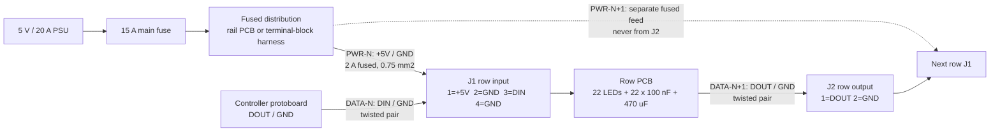

# Main Row PCB — 22-LED Board Build Guide

**Status:** active build guide, created 2026-11-25  
**Scope:** one identical row PCB, to be fabricated 10×  
**Spec:** see `PCB_V2_REFERENCE.md`  
**Do not edit:** any old/deleted `word_clock_row` project. Start a new KiCad project.

This file is enough to assemble and wire one row PCB without asking me. Follow it in order.

---

## 1. Locked decisions for this board

| Item | Value |
|---|---|
| Board size | **370 × 32 mm** |
| Copper | 2 layers, **1 oz**, FR4, 1.6 mm |
| LEDs | **22 × genuine Worldsemi WS2812B-V5**, PLCC4 5.0 × 5.0 mm |
| Per-LED capacitors | **22 × 100 nF X7R 0805**, Murata `GRM21BR71H104KA01L` or equivalent |
| Bulk capacitor | **1 × 470 µF / 10 V / 105 °C SMD aluminium electrolytic**, Panasonic FK `EEE-FK1A471P` or equivalent, 8 × 10.5 mm |
| Power input | Left terminal, **4-pin 3.50 mm fixed screw terminal**, `TerminalBlock_4Ucon:TerminalBlock_4Ucon_1x04_P3.50mm_Horizontal` |
| Data output | Right terminal, **2-pin 3.50 mm fixed screw terminal**, `TerminalBlock_4Ucon:TerminalBlock_4Ucon_1x02_P3.50mm_Horizontal` |
| Direction | **DIN left, DOUT right**, same on all 10 rows |
| Power topology | Each row gets its own fused +5 V feed. **No power daisy-chain.** |
| LED data order | Column-by-column: upper LED, then lower LED, then next column |
| PCB finish | **HASL, leaded or lead-free**, whichever is cheaper. No ENIG. |
| Coordinate origin | Board top-left = `(0, 0)`, X right, Y down. All coordinates in **mm**. |

No XT60 on this row board: the input needs four conductors (`+5V, GND, DIN, GND`) and the row only draws about 1.3 A worst case. A screw terminal is cheaper, lower-profile, and serviceable with a screwdriver. XT60 is better reserved for the future main supply input on the power-distribution board.

**Why 3.50 mm and not 5.00 mm:** the 5.00 mm 4-pin terminal body is ~21 mm long when rotated upright. The clear gap between the two left M3 holes (Y = 4 and 28, Ø3.2 mm) is only ~20.8 mm, so the 5.00 mm footprint courtyard clips both holes. The 3.50 mm terminal is ~15.7 mm long and fits with margin. The mounting holes are locked to the frame, so the connector changes instead.

LED centres are fixed by the light wells. The terminal footprints below are the exact ones used in this guide; if you substitute a different screw terminal, move only the terminals and capacitors, not the LED centres.

---

## 2. Wiring overview

The distribution block below can be the future power rail PCB or a terminal-block/fuse harness. The row PCB does not care which one is used.

### Cable labels

| Label | From | To | Conductors | Notes |
|---|---|---|---|---|
| `PWR-N` | Fused distribution output N | `J1.1`, `J1.2` | `+5V`, `GND` | 2 A fuse in +5 V only. GND is never fused. |
| `DATA-N` | Controller `DOUT/GND` or previous `J2` | `J1.3`, `J1.4` | `DIN`, `GND` | Twist together. Short return path for data. |
| `DATA-N+1` | `J2.1`, `J2.2` | Next row `J1.3`, `J1.4` | `DOUT`, `GND` | Twist together. Carries data only; no +5 V. |

`J2` is **data-only**. Do not use it to feed the next row's power.

**Physical pin order on the board:** `J1` is rotated 270° so its wire holes face the left/outward edge. That reverses the visible order. Top to bottom, `J1` is `GND (pin 4), DIN (pin 3), GND (pin 2), +5V (pin 1)`. Wire the harness by **pin number**, not by position. `J2` is rotated 90°, wire holes face the right/outward edge, and reads top-to-bottom `DOUT (pin 1), GND (pin 2)`.

---

## 3. Pinout and LED data order

### Connector pinout

| Connector | Pin | Net | Notes |
|---|---:|---|---|
| `J1` left, 4-pin | 1 | `+5V` | From fused distribution |
| `J1` left, 4-pin | 2 | `GND` | Power ground |
| `J1` left, 4-pin | 3 | `DIN` | From controller or previous row |
| `J1` left, 4-pin | 4 | `GND` | Data return, same GND net |
| `J2` right, 2-pin | 1 | `DOUT` | To next row `DIN` |
| `J2` right, 2-pin | 2 | `GND` | To next row data GND |

### WS2812B pinout

Looking at the LED package top:

| LED pin | Net |
|---:|---|
| 1 | `VDD` → `+5V` |
| 2 | `DOUT` |
| 3 | `GND` |
| 4 | `DIN` |

### Data chain

Firmware will remap these indices to letters, so this physical order is acceptable.

---

## 4. Parts, references, footprints and coordinates

All coordinates are local to one row PCB. Board outline is `(0,0)` to `(370,32)`.

### Full bill of materials

| Ref(s) | Qty/board | Qty/10 boards | Component | Value / part | KiCad symbol | KiCad footprint | Notes |
|---|---:|---:|---|---|---|---|---|
| `L01`…`L22` | 22 | 220 | Addressable RGB LED | **WS2812B-B/W (WS2812B V5)**, genuine Worldsemi, SMD5050-4P, 5.0 × 5.4 mm | `LED:WS2812B` — search `WS2812B`; some KiCad versions call it `Device:LED_WS2812B_PLCC4` | `LED_SMD:LED_WS2812B_PLCC4_5.0x5.0mm_P3.2mm` | Pin 1 = VDD, 2 = DOUT, 3 = GND, 4 = DIN. Avoid unbranded clones. |
| `C01`…`C22` | 22 | 220 | Ceramic capacitor | **100 nF, 50 V, X7R, 0805**, Murata `GRM21BR71H104KA01L` or equivalent | `Device:C` | `Capacitor_SMD:C_0805_2012Metric` | One directly beside each LED. X7R only; never Y5V/Z5U. |
| `C23` | 1 | 10 | SMD aluminium electrolytic | **470 µF, 10 V, 105 °C**, Panasonic FK `EEE-FK1A471P` or equivalent, 8 × 10.5 mm | `Device:C_Polarized` | `Capacitor_SMD:CP_Elec_8x10.5` | At the input. Pad 1 / `+` to `+5V`. 10 V gives margin on a 5 V rail. No wet THT part. |
| `J1` | 1 | 10 | 4-pin screw terminal | **4Ucon 20001 type**, 3.50 mm pitch, fixed screw clamp, 14.7 × 7 mm, ~8 A | `Connector_Generic:Conn_01x04` | `TerminalBlock_4Ucon:TerminalBlock_4Ucon_1x04_P3.50mm_Horizontal` | Left input: `+5V, GND, DIN, GND`. Direct wire entry, no mating plug needed. |
| `J2` | 1 | 10 | 2-pin screw terminal | **4Ucon 19963 type**, 3.50 mm pitch, fixed screw clamp, 7.7 × 7 mm, ~8 A | `Connector_Generic:Conn_01x02` | `TerminalBlock_4Ucon:TerminalBlock_4Ucon_1x02_P3.50mm_Horizontal` | Right output: `DOUT, GND`. Data only. |
| `H1`…`H4` | 4 NPTH | 40 NPTH | Mounting hole | M3 clearance, Ø3.2 mm | `Mechanical:MountingHole` — search `MountingHole`; some versions use `MountingHole:MountingHole` | `MountingHole:MountingHole_3.2mm_M3` | Add to schematic so they survive F8 updates. No copper. Use M3 screws/nuts/standoffs. |

### LCSC / INDIPCB quick reference

| Refs | Qty/board | MPN | Manufacturer | LCSC # | KiCad footprint | Notes |
|---|---:|---|---|---|---|---|
| `L01`…`L22` | 22 | `WS2812B-B/W` (WS2812B V5) | Worldsemi | **`C114586`** | `LED_SMD:LED_WS2812B_PLCC4_5.0x5.0mm_P3.2mm` | In stock; same V5 datasheet, pinout, footprint and brightness as `C2846931`. |
| `C01`…`C22` | 22 | `GRM21BR71H104KA01L` | Murata | **`C77082`** | `Capacitor_SMD:C_0805_2012Metric` | In stock. |
| `C23` | 1 | `BXJ10V470UF8*10` | SAMYOUNG | **`C2693598`** | `Capacitor_SMD:CP_Elec_8x10.5` | Replaces Panasonic `EEE-FK1A471P`; 8 × 10 mm body. |
| `J1` | 1 | `OSTTF040161` or `DB125-3.5-4P-GN-S` | On-Shore / DORABO | `C6249335` (0 stock) or **`C2757925`** (in stock) | `TerminalBlock_4Ucon:TerminalBlock_4Ucon_1x04_P3.50mm_Horizontal` | Keep footprint. DORABO body ~8.6 mm deep; dry-fit before bulk order. |
| `J2` | 1 | `OSTTF020161` or `DB301V-3.5-2P-GN-S` | On-Shore / DORABO | `C6722704` (0 stock) or **`C695629`** (in stock) | `TerminalBlock_4Ucon:TerminalBlock_4Ucon_1x02_P3.50mm_Horizontal` | Keep footprint. DORABO body ~8.5 mm deep; dry-fit before bulk order. |
| `H1`…`H4` | 4 | — | — | — | `MountingHole:MountingHole_3.2mm_M3` | NPTH, not a purchased part. |

LED choice: `C114586` is the recommended drop-in because its datasheet is WS2812B **V5**, with the same pin order (`VDD, DOUT, VSS, DIN`), SMD5050-4P footprint and 800 kbps timing as the specified part. `C2846931` (`WS2812B-V5`) is the exact old code but has 0 stock. `C2920042` (`WS2812E-V5`) is also pin/footprint/timing compatible and much cheaper, but it is the economy E version with different brightness/current and no reverse-polarity protection listed; use it only if the assembler confirms the MPN change is acceptable. `C4154881` (`WS2812B-XF01/W`) is pin-compatible but only ~40 pcs are listed at LCSC, far short of the ~220 LEDs needed for 10 rows.

Footprint strings are **not store part numbers**; search the LCSC code or MPN. KiCad has **no DORABO-specific footprint**. For `DB301V-3.5-2P-GN-S`, keep the existing 4Ucon footprint: in the PCB editor hover over `J2`, press **`E`**, click the footprint field’s folder icon, and search **`TerminalBlock_4Ucon_1x02_P3.50mm_Horizontal`**. If it is missing, install the standard `TerminalBlock_4Ucon.pretty` library. The same applies to `J1` with `TerminalBlock_4Ucon_1x04_P3.50mm_Horizontal`.

Mechanical hardware, not on the PCB BOM: per row use **4 × M3 screws**, **4 × M3 nuts**, and **4 × 6 mm M3 standoffs** to match the frame holes.

Why these parts: genuine LEDs avoid early failures, X7R capacitors hold value over temperature and age, the 105 °C SMD electrolytic is the only wet component, everything except the screw terminals is SMT-placeable, and HASL keeps fabrication cheap. Leaded HASL is easier to hand-solder; lead-free HASL is also fine electrically.

### Fixed-part coordinates

For both terminal footprints, KiCad's footprint origin is **pad 1**, not the body centre. The X/Y below is pad 1. `J1` uses 270° (pads run upward from pad 1); `J2` uses 90° (pads run downward). These rotations make both wire openings face outward.

| Ref | Footprint | X | Y | Rot | Notes |
|---|---|---:|---:|---:|---|
| `J1` | `TerminalBlock_4Ucon:TerminalBlock_4Ucon_1x04_P3.50mm_Horizontal` | 5.0 | 21.25 | 270° | Pin 1 `+5V` at Y = 21.25 (bottom), pin 2 `GND` at 17.75, pin 3 `DIN` at 14.25, pin 4 `GND` at 10.75 (top). Wire holes face left. |
| `J2` | `TerminalBlock_4Ucon:TerminalBlock_4Ucon_1x02_P3.50mm_Horizontal` | 356.5 | 14.25 | 90° | Pin 1 `DOUT` at Y = 14.25 (top), pin 2 `GND` at Y = 17.75 (bottom). Wire holes face right. |
| `C23` | `Capacitor_SMD:CP_Elec_8x10.5` | 26.5 | 16 | 0° | Pad 1 / `+` goes to `+5V`. Footprint origin is body centre. Moved from X=25 so the shifted `C01`/`C02` still have clearance. |
| `H1` | `MountingHole:MountingHole_3.2mm_M3` | 4 | 4 | 0° | NPTH |
| `H2` | `MountingHole:MountingHole_3.2mm_M3` | 366 | 4 | 0° | NPTH |
| `H3` | `MountingHole:MountingHole_3.2mm_M3` | 4 | 28 | 0° | NPTH |
| `H4` | `MountingHole:MountingHole_3.2mm_M3` | 366 | 28 | 0° | NPTH |

**Wire-entry direction:** these are horizontal side-entry terminals. Wire enters from **one long side only**. With this footprint the opening is on the side that faces outward when `J1` is at 270° and `J2` is at 90°. Confirm with the 3D viewer (`Alt+3`). `J1` at 270° reverses its visible pin order to `GND, DIN, GND, +5V` top-to-bottom; wire by pin number, not by position. `J2` at 90° reads `DOUT, GND` top-to-bottom.

If `J1` touches `H1`/`H3` or `L01`/`L02`, check that the old 5.00 mm footprint is gone. Click `J1`, press `E`, and confirm footprint `TerminalBlock_4Ucon:TerminalBlock_4Ucon_1x04_P3.50mm_Horizontal`, position `(5, 21.25)`, rotation `270°`. The courtyard is then X = 1.1…9.1 and Y = 8.15…23.85: about 2.5 mm clear of the M3 holes and 0.45 mm clear of the first LED courtyards (which start at X = 9.55). The 470 µF `C23` at `(26.5, 16)` is intentionally between `L01/L02` and `L03/L04`; leave it there.

### LEDs and 100 nF capacitors

`Lxx` = WS2812B. `Cxx` = its 100 nF capacitor. All rotations are 0°. For the LEDs and 0805 capacitors, KiCad's footprint origin is the **body centre**, so the X/Y below is the body centre measured from the board top-left corner — not from the PCB centre and not from a pad. Only `J1`/`J2` use pad 1 as their origin. Cap centre X = LED X **+ 5.6 mm**. The earlier +4.8 mm value made the 0805 courtyard overlap the LED courtyard by 0.35 mm; +5.6 mm leaves ~0.45 mm between courtyards.

| Ref pair | Column | LED X | LED Y | Cap X | Cap Y |
|---|---:|---:|---:|---:|---:|
| `L01` / `C01` | 0 | 13.0 | 10 | 18.6 | 10 |
| `L02` / `C02` | 0 | 13.0 | 22 | 18.6 | 22 |
| `L03` / `C03` | 1 | 46.2 | 10 | 51.8 | 10 |
| `L04` / `C04` | 1 | 46.2 | 22 | 51.8 | 22 |
| `L05` / `C05` | 2 | 79.4 | 10 | 85.0 | 10 |
| `L06` / `C06` | 2 | 79.4 | 22 | 85.0 | 22 |
| `L07` / `C07` | 3 | 112.6 | 10 | 118.2 | 10 |
| `L08` / `C08` | 3 | 112.6 | 22 | 118.2 | 22 |
| `L09` / `C09` | 4 | 145.8 | 10 | 151.4 | 10 |
| `L10` / `C10` | 4 | 145.8 | 22 | 151.4 | 22 |
| `L11` / `C11` | 5 | 179.0 | 10 | 184.6 | 10 |
| `L12` / `C12` | 5 | 179.0 | 22 | 184.6 | 22 |
| `L13` / `C13` | 6 | 212.2 | 10 | 217.8 | 10 |
| `L14` / `C14` | 6 | 212.2 | 22 | 217.8 | 22 |
| `L15` / `C15` | 7 | 245.4 | 10 | 251.0 | 10 |
| `L16` / `C16` | 7 | 245.4 | 22 | 251.0 | 22 |
| `L17` / `C17` | 8 | 278.6 | 10 | 284.2 | 10 |
| `L18` / `C18` | 8 | 278.6 | 22 | 284.2 | 22 |
| `L19` / `C19` | 9 | 311.8 | 10 | 317.4 | 10 |
| `L20` / `C20` | 9 | 311.8 | 22 | 317.4 | 22 |
| `L21` / `C21` | 10 | 345.0 | 10 | 350.6 | 10 |
| `L22` / `C22` | 10 | 345.0 | 22 | 350.6 | 22 |

### Global placement in the 600 mm frame

Local origin of each row is:

| Row | Global top-left X | Global top-left Y |
|---:|---:|---:|
| 1 | 114.972 | 116.2410 |
| 2 | 114.972 | 153.5124 |
| 3 | 114.972 | 190.7838 |
| 4 | 114.972 | 228.0552 |
| 5 | 114.972 | 265.3266 |
| 6 | 114.972 | 302.5980 |
| 7 | 114.972 | 339.8694 |
| 8 | 114.972 | 377.1408 |
| 9 | 114.972 | 414.4122 |
| 10 | 114.972 | 451.6836 |

---

## 5. KiCad schematic — do these steps in order

1. **Create a new KiCad project.**  
   Suggested folder: `hardware/60cm/kicad/wordClock/`. Do not open or restore the old `word_clock_row` project.

2. **Open the schematic editor.**

3. **Place symbols:**

   | Qty | Symbol | Value | Footprint to assign |
   |---:|---|---|---|
   | 22 | `LED:WS2812B` — search `WS2812B`; some versions use `Device:LED_WS2812B_PLCC4` | `WS2812B-V5` | `LED_SMD:LED_WS2812B_PLCC4_5.0x5.0mm_P3.2mm` |
   | 22 | `Device:C` | `100n` | `Capacitor_SMD:C_0805_2012Metric` |
   | 1 | `Device:C_Polarized` | `470u` | `Capacitor_SMD:CP_Elec_8x10.5` |
   | 1 | `Connector_Generic:Conn_01x04` | `ROW_IN` | `TerminalBlock_4Ucon:TerminalBlock_4Ucon_1x04_P3.50mm_Horizontal` |
   | 1 | `Connector_Generic:Conn_01x02` | `ROW_OUT` | `TerminalBlock_4Ucon:TerminalBlock_4Ucon_1x02_P3.50mm_Horizontal` |
   | 1 | `Power:PWR_FLAG` on `+5V` | — | — |
   | 1 | `Power:PWR_FLAG` on `GND` | — | — |

4. **Annotate schematic** so references become `L01…L22`, `C01…C23`, `J1`, `J2`.

5. **Add net labels:**  
   `+5V`, `GND`, `DIN`, `DOUT`.

6. **Wire `J1`:**

   - `J1.1` → `+5V`
   - `J1.2` → `GND`
   - `J1.3` → `DIN`
   - `J1.4` → `GND`

7. **Wire `J2`:**

   - `J2.1` → `DOUT`
   - `J2.2` → `GND`

8. **Wire every LED power pin:**

   - LED pin 1 → `+5V`
   - LED pin 3 → `GND`

9. **Wire every 100 nF capacitor:**

   - One side → `+5V`
   - Other side → `GND`
   - Keep each capacitor paired with its LED number: `C01` with `L01`, etc.

10. **Wire `C23`:**

    - `+` / pin 1 → `+5V`
    - `−` / pin 2 → `GND`

11. **Wire the data chain.** Drawing physical wires is optional; net labels are cleaner and electrically identical. Use local labels with this exact pattern:

    | Pin | Label |
    |---|---|
    | `J1.3` | `DIN` |
    | `L01.4` | `DIN` |
    | `L01.2` | `N01` |
    | `L02.4` | `N01` |
    | `L02.2` | `N02` |
    | `L03.4` | `N02` |
    | … | … |
    | `L21.2` | `N21` |
    | `L22.4` | `N21` |
    | `L22.2` | `DOUT` |
    | `J2.1` | `DOUT` |

    Rule: for LED `n`, pin 4 gets `N(n-1)` and pin 2 gets `Nn`, with `L01` pin 4 using `DIN` and `L22` pin 2 using `DOUT`. Labels are case-sensitive; put each label on the pin or on a tiny stub coming out of it. Do not put two different labels on the same net.

12. **Run ERC.** Target: **0 violations**.  
    If KiCad complains that power nets are not driven, confirm the two `PWR_FLAG` symbols are present.  
    ERC = 0 also confirms that duplicated LED/capacitor pairs were renumbered correctly and that every label-based net connection exists.

### 5A. Add the four M3 mounting holes to the schematic

Do this now, before final PCB layout:

1. Place **4 × `Mechanical:MountingHole`** symbols.  
   Search `MountingHole`. Some KiCad versions put it in the `MountingHole` library instead; either symbol with no pins is fine.
2. Annotate them so they become `H1`, `H2`, `H3`, `H4`.
3. Assign this footprint to all four: `MountingHole:MountingHole_3.2mm_M3`.
4. Leave them unwired. They have no electrical pins and do not affect ERC.
5. Re-run ERC; it must still be **0 violations**.
6. Press `F8` again to update the PCB so `H1…H4` appear on the board.

---

## 6. KiCad PCB — do these steps in order

### 6.0 First-run PCB editor setup

If KiCad shows a message about units/grid when the PCB editor opens, accept it, then explicitly set the values below.

1. Set **units to mm** using the units control at the top-left of the PCB editor.
2. Set the **grid to 0.1 mm** using the grid dropdown at the top.  
   If 0.1 mm is not listed, add it in `Preferences → Preferences → PCB Editor → Grids`. A 0.05 mm grid is also useful for fine routing but is not required.
3. Open `File → Board Setup…` and set:
   - **Board Stackup:** 2 copper layers, board thickness **1.6 mm**, copper **1 oz / 0.035 mm**.
   - **Design Rules → Constraints:**
     - Clearance: **0.15 mm** — 6 mil, standard for cheap fabs; allows the larger 0.40 mm vias
     - Minimum track width: **0.20 mm**
     - Minimum via diameter: **0.70 mm**
     - Minimum via drill: **0.40 mm** — cheap fabs commonly reject 0.30 mm drills
     - Copper-to-edge clearance: **0.50 mm**
   - **Net Classes:**
     - `Default`: clearance **0.15 mm**, track **0.25 mm**, via **0.70 / 0.40 mm**
     - Add class `POWER`: assign nets `+5V` and `GND`, clearance **0.15 mm**, track **1.2 mm**, via **0.70 / 0.40 mm**
   - **Masks / Silkscreen:** solder mask expansion **0.05 mm**; silkscreen text height **0.8 mm**, thickness **0.12 mm**.
4. Click **OK**.
5. Save the board. Then continue with step 1 below.

1. **Update PCB from schematic** (`F8`): Tools → Update PCB from Schematic.

2. **Set units to mm and grid to 0.1 mm.**  
   Use local board coordinates with the top-left of the PCB as `(0,0)`.

3. **Draw the board outline on `Edge.Cuts`:**  
   Rectangle from `(0,0)` to `(370,32)`.  
   `Edge.Cuts` is only for the outline. After drawing it, switch the active layer to **`F.Cu`** before placing any footprints.

4. **Place the four M3 holes** from the Fixed-part coordinates table: `(4,4)`, `(366,4)`, `(4,28)`, `(366,28)`.  
   Use NPTH `MountingHole_3.2mm_M3`. Keep at least 1 mm copper clearance.  
   If you placed them while `Edge.Cuts` was active, click each hole, press `E`, and confirm **Layer = Front**. If it says Back, press `F` to flip it. If `Edge.Cuts` contains anything other than the outline rectangle, delete the extra item.

5. **Place `J1`, `J2`, and `C23`** from the Fixed-part coordinates table while the active layer is **`F.Cu`**. The footprint side selector only offers `F.Cu` / `B.Cu`; that is normal — pick `F.Cu` for front-side parts. Other layers such as `Edge.Cuts` and `F.Silkscreen` are in the right-hand Appearance panel. Remember that the terminal footprint X/Y is pad 1, not the body centre.  
   Check the pin order visually on the silkscreen:
   - `J1` top to bottom: `GND (pin 4), DIN (pin 3), GND (pin 2), +5V (pin 1)` at Y = 10.75, 14.25, 17.75, 21.25, rotation 270°, wire holes face left.
   - `J2` top to bottom: `DOUT (pin 1), GND (pin 2)` at Y = 14.25, 17.75, rotation 90°, wire holes face right.
   - `C23` plus pad goes to `+5V`, centre `(26.5, 16)`. It sits between `L01/L02` and `L03/L04`; that is correct.
   - Each 100 nF cap sits at `LED X + 5.6`, same Y as its LED. Do not use the old `+4.8` values.
   - If `J1` still touches a mounting hole or LED, check Properties: footprint must be the 3.50 mm type, position `(5, 21.25)`, rotation `270°`.

6. **Place the 22 LED / capacitor pairs** from the coordinate table.  
   Keep all LEDs at the same rotation. Pin 1 marking must match the schematic pinout.

7. **Route data first** with 0.25 mm tracks:

   `J1.3 → L01.4 → L01.2 → L02.4 → L02.2 → … → L21.2 → L22.4 → J2.1`

   Keep the data trace short and away from the board edges. No vias on data if avoidable.

8. **Connect power pads:**

   - All LED pin 1 and all 100 nF + pads → `+5V`
   - All LED pin 3, all 100 nF − pads, `J1.2`, `J1.4`, `J2.2` → `GND`
   - `J1.1` → `+5V`
   - Use 1.0–1.5 mm tracks from `J1` to the pours.

9. **Add copper zones** — do this *after* routing, whether routing was manual or by Freerouting. See §6B for the exact keybinds.

   - `F.Cu`: `+5V` zone, clearance 0.25 mm, thermal reliefs.
   - `B.Cu`: `GND` zone, clearance 0.25 mm, thermal reliefs. Do not use solid connection on the through-hole terminal pads; thermal reliefs make hand soldering possible.
   - Fill zones with `B`.
   - Do **not** pour `+5V` on `B.Cu`; `B.Cu` is the ground plane.
   - LED and capacitor GND pads are SMD on `F.Cu`. If DRC reports unconnected GND pads after filling, add a GND via next to each such pad and a short `F.Cu` track to it, then refill with `B`.

### 6A. Routing with Freerouting (use instead of manual steps 7–9)

1. **Do not pour zones yet.** Zones are added *after* the autorouter finishes.
2. In `File → Board Setup → Net Classes`, confirm: `Default` track **0.25 mm**, `POWER` track **1.2 mm**, clearance **0.15 mm**, via **0.70 / 0.40 mm**. Freerouting reads these from the exported file.
3. In KiCad: `File → Export → Specctra DSN…` and save `row_v2.dsn`.
4. Open `row_v2.dsn` in Freerouting. Check the same rules there, then start the autorouter.
5. Save the result as `row_v2.ses`.
6. Back in KiCad: `File → Import → Specctra Session…`, select `row_v2.ses`.
7. Run **DRC** and clear every error. Then go to §6B for zones and silkscreen.
8. Verify: all 21 data nets connect `J1.3 → L01.4 → … → L22.2 → J2.1`; `J2` has no `+5V`; no unrouted pads remain.

Freerouting can route the thin data nets with long detours. Electrically that is fine — the schematic labels define the chain, not the physical path. Keep 5 V and GND as planes, not daisy-chained tracks.

### 6B. Zones and silkscreen while the board is open — keybinds

**Add the `+5V` zone:**

1. In the right-hand **Appearance → Layers** panel, click **`F.Cu`** so it is the active layer.
2. Press **`Ctrl+Shift+Z`** (`Draw Filled Zones`). In KiCad 9, click once to set the first corner and the Zone Properties dialog opens immediately; in KiCad 8, draw the rectangle first and the dialog opens at the end. If no dialog appears, press `E` with the zone outline selected.
3. In Zone Properties set: **Net = `+5V`**, **Layer = `F.Cu`**, **Clearance = 0.25 mm**, **Pad connection = Thermal reliefs**, **Remove islands = Always**. Click OK.
4. Click the remaining three corners just inside the board outline. Double-click the last corner to finish. Approximate corners are fine — the zone automatically respects the 0.5 mm copper-to-edge rule.
5. Press `Esc` to leave the zone tool.

**Add the `GND` zone:**

6. Click **`B.Cu`** in Appearance → Layers to make it active.
7. Press **`Ctrl+Shift+Z`** again. Set **Net = `GND`**, **Layer = `B.Cu`**, **Clearance = 0.25 mm**, **Pad connection = Thermal reliefs**, **Remove islands = Always**.
8. Draw the same rectangle and double-click to finish. Press `Esc`.
9. Press **`B`** (`Fill All Zones`). The copper fills appear. Press `B` again any time you move something.

**Add silkscreen text:**

10. Click **`F.Silkscreen`** in Appearance → Layers.
11. Press **`Ctrl+Shift+T`** (`Draw Text`), then click where the text should go. The Text Properties dialog opens.
12. Set **Layer = `F.Silkscreen`**, **Text height = 0.8 mm**, **Text thickness = 0.12 mm**, type the text, click OK.
13. Press `Esc` to exit the text tool. To edit any text later, click it and press `E`; to delete, press `Del`.

Suggested labels (click roughly in these areas; DRC will warn if text lands on a pad):

| Text | Approximate spot |
|---|---|
| `J1 5V / GND / DIN / GND` | above `J1`, around X=12, Y=5 |
| `J2 DOUT / GND` | above `J2`, around X=350, Y=5 |
| `470uF +` | above `C23`, around X=26.5, Y=7 |
| `ROW 1-10 - FUSED 5V INPUT` | bottom centre, around X=185, Y=29 |

### 6C. Fixing Freerouting DRC results

Freerouting often imports tracks at **0.1874 mm** even when the KiCad `Default` netclass says 0.25 mm. DRC then reports `track_width` errors. Fix in KiCad:

1. The bulk editor only lists **pre-defined** widths. If the dropdown shows only `-- leave unchanged --`, first add one:
   - `File → Board Setup… → Design Rules → Pre-defined Sizes` → in the **Tracks** list click `+` → enter **0.25 mm** → OK.
   - Reopen `Edit → Edit Track & Via Properties…`, tick the **Tracks** scope, leave all filters off, choose **Set to specified values**, pick **0.25 mm** from the dropdown → OK.
   - This clears the width errors. Power is carried by the zones, so the thin power tracks do not need to become 1.2 mm.
   - Faster alternative if the above is awkward: `File → Board Setup… → Design Rules → Constraints → Minimum track width = 0.18 mm`. The existing 0.1874 mm tracks then pass DRC unchanged; 0.1874 mm is well within normal fabrication capability.
2. If DRC reports `starved_thermal` on a pad (for example `C20` pad 1 with only one spoke), click that pad, press `E`, and set **Connection to copper zones = Solid**. Alternatively, press `E` on the `+5V` zone outline and set **Minimum spoke count = 1**.
3. Press **`B`** to refill zones, then run DRC again.
4. If power tracks still worry you: in `File → Board Setup → Net Classes`, assign `+5V` and `GND` to the `POWER` class, re-export the DSN and reroute. This is optional once the zones exist.

### 6D. Fabs that reject 0.30 mm vias

Some cheap fabs have a **0.40 mm minimum drill**. The 3.2 mm M3 holes and terminal pins are fine; the 0.30 mm drills are the signal vias Freerouting added. Change every via to **0.70 mm diameter / 0.40 mm drill**:

1. `File → Board Setup… → Design Rules → Pre-defined Sizes` → **Vias** list → `+` → add **0.70 / 0.40 mm** → OK.
2. `Edit → Edit Track & Via Properties…` → tick only the **Vias** scope → leave filters off → **Set to specified values** → choose **0.70 / 0.40 mm** → OK.
3. If the dropdown still shows only `-- leave unchanged --`, close the dialog and add the via size in step 1; the bulk editor only lists pre-defined sizes.
4. `File → Board Setup… → Design Rules → Constraints` → set **Minimum via drill = 0.40 mm**, **Minimum via diameter = 0.70 mm**.
5. Press **`B`** to refill zones, run DRC again, then regenerate the drill files.

Fiducials and extra thermal reliefs are optional DFM suggestions. Ask the assembler if they require fiducials; do not add them to `Edge.Cuts`.

### 6E. Clearance errors after enlarging vias

A 0.70 / 0.40 mm via is wider than 0.60 / 0.30 mm, so old 0.20 mm clearance rules can fail at about 0.15–0.19 mm. The copper itself is fine; lower the rule to **0.15 mm (6 mil)**:

1. `File → Board Setup… → Design Rules → Constraints` → **Clearance = 0.15 mm**.
2. `File → Board Setup… → Net Classes` → set **Default = 0.15 mm** and **POWER = 0.15 mm** clearance. Zone clearance may stay 0.25 mm.
3. Press **`B`**, run DRC again. Target: **0 violations, 0 unconnected pads**.
4. Re-export Gerbers and drills.

If your fab requires 0.20 mm clearance instead, move the listed vias 0.1–0.2 mm away from the neighbouring tracks; do not lower the drill back to 0.30 mm.

10. **Run DRC.** Target: **0 errors**.  
    Fix unconnected items, zone islands, silkscreen-over-pad warnings, and courtyard overlaps.

11. **Export Gerbers and drill files** only after DRC is clean.
    - `File → Plot…`: format **Gerber**, plot layers `F.Cu`, `B.Cu`, `F.Silkscreen`, `F.Mask`, `B.Mask`, `Edge.Cuts`. Output folder `gerbers/`. Click **Plot**.
    - In the same dialog click **Generate Drill Files…**: format **Excellon**, units **mm**. Generate the drill file and drill map.
    - Zip the Gerber files plus the drill file for the fabricator. Do not send the `.kicad_pcb`.

12. **Export BOM and CPL (pick-and-place).** Neither has a default hotkey; use the menus.

    **BOM — in the schematic editor**

    1. Open the `.kicad_sch` tab and press `Ctrl+S`.
    2. `Tools → Generate Bill of Materials…` (older KiCad: `Tools → Generate BOM…`). The Symbol Fields Table opens.
    3. **Edit** tab: Scope = **Entire schematic**. Show `Reference`, `Value`, `Footprint`, `${QUANTITY}`. Tick **Group By** for `Value` and `Footprint`. If `H1`–`H4` appear, select them in the schematic, press `E`, tick **Exclude from bill of materials**, save, and reopen the BOM tool.
    4. Expected rows: `L01…L22` qty 22, `C01…C22` qty 22, `C23` qty 1, `J1` qty 1, `J2` qty 1. For ten boards, order **10×** these quantities.
    5. **Export** tab: output file `bom/row_v2_bom.csv`, format **CSV**, comma delimiter, `"` text delimiter. Check the preview, click **Export**.
    6. Do not use `File → Fabrication Outputs → BOM…` in the PCB editor; it carries less information.

    **CPL — in the PCB editor**

    7. Open the `.kicad_pcb` tab. `File → Fabrication Outputs → Component Placement (.pos, .gbr)…`.
    8. Set **Format = CSV**, **Units = mm**. Tick **Include only SMD footprints** and **Exclude all footprints with through hole pads**. Leave **Use drill/place file origin** unticked unless you deliberately set one. Leave **Generate single file with both front and back positions** unticked.
    9. Output file `cpl/row_v2_top.cpl` (or `.pos`). Click **Generate**.
    10. Open the CSV in Notepad. It must contain exactly **45 rows**: `L01…L22`, `C01…C22`, `C23`. If `J1`/`J2` or `H1`–`H4` appear, select those footprints on the PCB, press `E`, tick **Exclude from position files**, and regenerate.
    11. Send the CPL to the assembler and ask them to confirm the rotation convention. This board is top-side only, so no bottom-side mirroring is needed.

---

## 7. Assembly order

All 45 components (`L01…L22`, `C01…C22`, `C23`, `J1`, `J2`) can be placed by an SMT line except the two screw terminals, which are through-hole and hand-soldered. The four M3 holes are NPTH hardware, not components. The 470 µF part is 10.5 mm tall; confirm your assembler accepts that height, which most do.

1. Solder `C01…C22` 100 nF capacitors.
2. Solder `L01…L22` WS2812B LEDs. Check the pin 1 mark before soldering.
3. Solder `C23` 470 µF; observe polarity.
4. Solder `J1` and `J2`; check pin order.
5. Measure resistance between `+5V` and `GND`. It must not be near 0 Ω.
6. Power from a current-limited 5 V supply first. Expected full-white worst case for one row: about **1.3 A**.
7. Run a test pattern lighting 22 LEDs. Confirm `L01` is first and `L22` is last.

---

## 8. Checklist before ordering

- [ ] `H1…H4` are in the schematic with footprint `MountingHole:MountingHole_3.2mm_M3`.
- [ ] PCB editor units = mm, grid = 0.1 mm, Board Setup saved as in §6.0.
- [ ] Board outline exactly 370 × 32 mm.
- [ ] Four M3 NPTH holes at `(4,4)`, `(366,4)`, `(4,28)`, `(366,28)`.
- [ ] 22 LED centres exactly as in the table.
- [ ] 22 × 100 nF, one per LED.
- [ ] One SMD 470 µF / 10 V / 105 °C at the input, footprint `CP_Elec_8x10.5`.
- [ ] `J1` is 4-pin 3.50 mm `TerminalBlock_4Ucon_1x04_P3.50mm_Horizontal`, pad 1 at `(5, 21.25)`, rotation 270°, top-to-bottom `GND, DIN, GND, +5V`; wire holes face the left board edge.
- [ ] `J2` is 2-pin 3.50 mm `TerminalBlock_4Ucon_1x02_P3.50mm_Horizontal`, pad 1 at `(356.5, 14.25)`, rotation 90°, top-to-bottom `DOUT, GND`; wire holes face the right board edge.
- [ ] No terminal courtyard overlaps `H1`, `H2`, `H3` or `H4`.
- [ ] `J2` carries **no +5 V**.
- [ ] `+5V` on `F.Cu`, `GND` on `B.Cu`.
- [ ] HASL finish selected, leaded or lead-free; no ENIG.
- [ ] ERC and DRC both clean.
- [ ] Silkscreen labels present.

Skipped: no KiCad project files were created in this step; this is the build guide only.  
Risk: this BOM assumes the exact footprints listed above; substituting a different terminal or capacitor requires a courtyard/pin-order recheck before fabrication.
